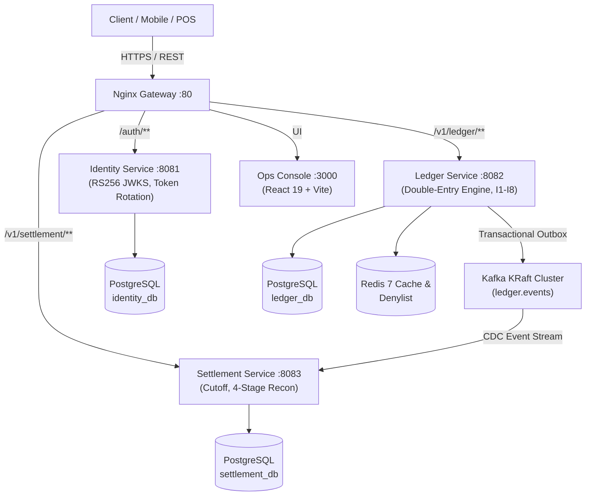

# PayCore: Payments & Settlement Platform

[](https://adoptium.net)
[](https://spring.io/projects/spring-boot)
[](https://www.postgresql.org)
[](https://react.dev)
[](LICENSE)

**PayCore** is a double-entry financial ledger, automated multi-stage settlement, and reconciliation platform built for multi-sided marketplaces. It provides mathematical accounting guarantees (Invariants I1 to I8), four hot-account concurrency strategies sustaining up to **3,906 req/s** on mixed workloads, automated bank/provider clearing with dynamic programming subset-sum solving, and dual-control maker-checker dispute resolution.

---

## Architecture Overview



---

## Core Financial Guarantees (Invariants I1 to I8)

PayCore provides mathematical and architectural invariants verified by property-based testing (1,500 jqwik checks), database triggers, and continuous integrity audits:

| Invariant | Guarantee | Enforcement Mechanism |
| :--- | :--- | :--- |
| **I1: Double-Entry Zero Sum** | $\sum \text{Debits} = \sum \text{Credits}$ across all legs of every journal. | Validated in domain value object and application layer before commit. |
| **I2: Immutability** | Ledger entries cannot be modified or deleted. | PostgreSQL trigger `trg_ledger_entry_immutability` blocks `UPDATE` and `DELETE`. |
| **I3: Global Balance Correctness** | Global debits equal global credits across the whole ledger. | Verified via continuous integrity service (`GET /v1/integrity`). |
| **I4: Balance Derivability** | Cached account balance equals sum of entries (or sum of stripes). | Stripe summation in `account_stripes` table; nightly integrity reconciliation. |
| **I5: Payout Available Balance** | Payout requests never exceed available `SELLER_PAYABLE` (refunds allow negative). | Atomic row lock `SELECT FOR UPDATE` and available balance validation. |
| **I6: Idempotency** | Duplicate client requests with same key and payload return cached response without duplicate posting. | Atomic claim and response caching in `idempotency_keys` table. |
| **I7: Refund Cap** | Total refunds on a payment never exceed original captured gross amount. | Cumulative refund sum verification inside payment posting transaction. |
| **I8: Business Operation Linkage** | Every journal links to at most one business operation and idempotency key. | Unique constraints on `payments.journal_id`, `refunds.journal_id`, `payouts.journal_id`, and `journals(scope, idempotency_key)`. |

---

## Hot-Account Concurrency Benchmark Summary

When high-volume marketplaces process transactions, central platform accounts (`PROVIDER_RECEIVABLE` and `PLATFORM_FEE_REVENUE`) suffer severe write contention. PayCore implements and benchmarks four concurrency strategies per Playbook Section 9:

| Strategy | Description | W1 Captures (Peak) | W2 Mixed (Peak) | W3 Pareto (Peak) | Abort Rate (c=128) |
| :--- | :--- | :---: | :---: | :---: | :---: |
| **S0: Pessimistic Lock** | Full-transaction row lock via ascending UUID order. | 922.6 req/s | 990.5 req/s | 1,037.8 req/s | 0.0% |
| **S1: Late-Lock** | Row lock deferred to commit window. | 1,965.1 req/s | 2,129.9 req/s | 2,221.2 req/s | 5.51% (serialization conflicts) |
| **S2: Striped Accounts** | Hot account balance partitioned across $N=16$ stripes. | **3,816.4 req/s** | **3,905.6 req/s** | **3,899.7 req/s** | **0.0%** |
| **S4: Ledger-Only** | Append-only event sourcing with async snapshots. | 3,791.6 req/s | 3,731.3 req/s | 3,755.5 req/s | 0.0% |

*Measurements taken on Linux 7.2.15-omarchy-x86_64 across 240 benchmark executions. Selection by Decision Rule: `S2_STRIPED` (highest sustained throughput with p99 < 12 ms, zero aborts, and live balance). Detailed report in [docs/benchmark-report.md](docs/benchmark-report.md).*

---

## Crash Recovery Verification (50-Iteration Real Process SIGKILL Harness)

To guarantee ACID durability against sudden process termination, PayCore includes an automated 50-iteration crash harness ([scripts/crash-test](scripts/crash-test)):

```bash
# Results over 50 real process SIGKILL termination cycles during live W2 mixed transactions:
Iteration 50/50: PASSED (Recovery time: 59.93 ms, Invariants: PASS)
================================================================================
Crash Verification Summary:
Total cycles executed: 50
Total cycles passed:   50 (100.0%)
Data integrity violations (I1 to I8): 0
Average recovery time: 67.21 ms (median 67.92 ms, p95 74.67 ms)
================================================================================
```
*Empirical results and per-iteration recovery distribution recorded in [docs/crash-test-report.md](docs/crash-test-report.md).*

---

## Multi-Stage Reconciliation Engine

PayCore includes an automated 4-stage reconciliation engine capable of resolving line-level and composite bank deposits against internal ledger batches:

1. **Stage 1 (Exact Line Match):** Chunked join on `provider_txn_id` and gross amounts. Detects exact fee variances based on configured contract basis points.
2. **Stage 2 (Fuzzy Fallback Match):** Matching on order reference ID (95% confidence) and strictly unique $\pm 10$ minute timestamp windows (85% confidence).
3. **Stage 3 (Batch to Deposit Clearing via Subset Sum):** Resolves lump-sum bank deposits matching composite settlement batches using a bounded meet-in-the-middle / dynamic programming solver ($N \le 40$ batches, 5-second timeout, 100,000 state cap). Ambiguous multi-subset collisions are flagged for human operator review.
4. **Stage 4 (Ledger Clearing):** Atomic state transitions transitioning candidate records, batches, and bank deposits to `RECONCILED`.

---

## Discrepancy Cases & Dual-Control Maker-Checker

Discrepancies detected during reconciliation automatically spawn `DiscrepancyCase` entities governed by strict SLA deadlines:
- **Automated SLA Escalation Daemon:** Minute-interval background worker detecting breached deadlines, escalating severity (`LOW` $\to$ `MEDIUM` $\to$ `HIGH` $\to$ `CRITICAL`), extending deadlines, and emitting timeline audit notes.
- **Dual-Control Maker-Checker:** Operational and dispute financial adjustments require two distinct operators. An `ANALYST` proposes an adjustment, and an independent `ADMIN` must approve it. Self-approval is rejected by application logic and blocked at the PostgreSQL schema layer (`ck_cases_maker_checker`).

---

## Operations Console (React 19)

The operations console provides web-based management with enterprise security:
- **Zero LocalStorage Tokens:** Access tokens are stored strictly in-memory. Refresh tokens are exchanged via secure `httpOnly`, `SameSite=Strict` cookies with a single-flight mutex lock preventing refresh race conditions.
- **Reconciliation Workbench:** Streaming CSV file upload with SHA-256 fingerprinting, trailer validation preview, and ground-truth precision/recall metrics.
- **Discrepancy Cases:** Interactive Kanban board (`OPEN`, `IN_REVIEW`, `ESCALATED`, `RESOLVED`) and table list view with optimistic status transitions and HTTP 409 conflict detection.
- **Ledger Statement Explorer:** Keyset-paginated double-entry statement browser with available, locked, and total balance breakdowns.
- **Merchant Self-Service Portal:** Merchant portal (`/me`) displaying real-time available balance, active authorization holds, and transaction history.
- **Immutable Audit Trail:** Searchable security and financial audit log with expandable JSON event payloads.

---

## Quick Start & Verification

### Prerequisites
- Java 21 LTS (`java -version`)
- Maven 3.9+ (`mvn -version`)
- Docker & Docker Compose (`docker compose version`)
- Node.js 22+ (`node -v`)

### 1. Start Infrastructure
```bash
docker compose --profile core up -d
```
Starts PostgreSQL 16 (with isolated databases: `identity`, `ledger`, `settlement`), Redis 7, Kafka KRaft, and Nginx reverse proxy.

### 2. Build & Verify Entire Reactor
```bash
./mvnw clean verify
```
Compiles all 5 modules, executes all 77 automated test suites, validates Spotless Google Java formatting, and runs property-based tests.

### 3. Build Frontend Ops Console
```bash
cd web/ops-console
npm install
npm run build
```

### 4. Run Operational SOPs
Review standard operating procedures in [docs/runbook.md](docs/runbook.md) for daily cutoff execution, file ingestion recovery, crash recovery auditing, and invariant checks.

---

## Project Structure

```
paycore/
├── libs/
│   └── paycore-common/         # Shared Money value object, RequestIdFilter, Security filters
├── services/
│   ├── identity-service/       # RS256 JWKS publisher, refresh rotation, user admin
│   ├── ledger-service/         # Double-entry posting engine, hot-account strategies, holds/payouts
│   └── settlement-service/     # Cutoff batching, streaming file parser, recon engine, maker-checker
├── web/
│   └── ops-console/            # React 19 + TypeScript + Tailwind Ops Console
├── benchmarks/
│   ├── k6/                     # Parameterized load tests (W1 uniform, W2 Pareto, W3 hot-spot)
│   └── runner.sh               # Automated benchmark execution script
├── tests/
│   └── crash-harness/          # 50-cycle SIGKILL crash test harness
├── deploy/                     # Docker compose, PostgreSQL init scripts, Nginx gateway
└── docs/
    ├── runbook.md              # Operational SOPs and SQL invariant audit scripts
    ├── hot-account-report.md   # Hot-account concurrency benchmark findings
    └── adr/                    # Architectural Decision Records (ADR-001 to ADR-005)
```

---

## Third-Party Notices & Attribution

PayCore builds on patterns and infrastructure from open-source MIT-licensed repositories:
- **`Dedmoo/RetailBankingCore`** (commit `955c2f7`): Outbox pattern messaging, Redis token bucket rate limiting patterns, and Testcontainers baseline configuration.
- **`Gabrielab5/IssuesFlow`** (commit `ef4bd84`): Frontend layout architecture, scheduled daemon pattern, and JWT token deny-list structure.

Complete licensing details and attribution notices are documented in [THIRD_PARTY_NOTICES.md](THIRD_PARTY_NOTICES.md).
