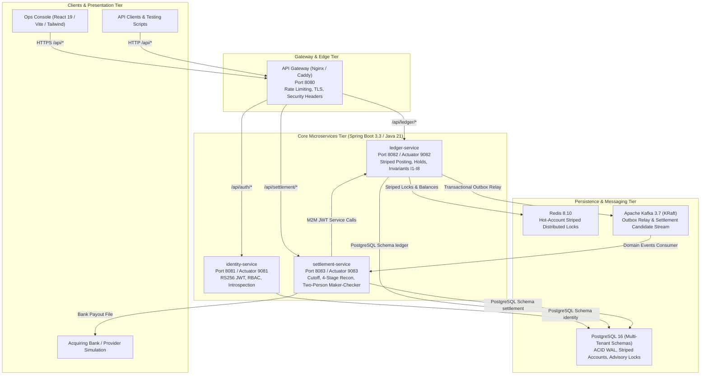

# PayCore System Architecture & C4 Container Specification

## 1. System Overview
PayCore is a distributed, high-throughput payments and settlement platform engineered for high-concurrency ledger operations, guaranteed transactional consistency, and zero double-entry accounting drift.

The platform coordinates authentication, real-time merchant onboarding, payment capture, authorization holds, partial refunds, automated batch settlement cutoffs, multi-stage reconciliation against provider settlement files, and dual-control operational adjustments.

---

## 2. C4 Container Diagram

---

## 3. Core Component Responsibilities

### A. Identity Service (`identity-service`)
- **RS256 Asymmetric Cryptography:** Signs stateless access tokens using RSA 2048-bit private keys; exposes public JWKS at `/.well-known/jwks.json`.
- **Role-Based Access Control (RBAC):** Supports hierarchical roles (`ADMIN`, `ANALYST`, `OPERATOR`, `MERCHANT`, `SERVICE`).
- **Machine-to-Machine (M2M) Authentication:** Issues scoped client tokens for inter-service communication (`/auth/service-token`).
- **Audit Logging:** Immutably records security events, logins, and permission checks to JSONB audit tables.

### B. Ledger Service (`ledger-service`)
- **Double-Entry Engine:** Ensures total debits equal total credits for every transaction leg ($I1$).
- **Hot-Account Mitigation:** Implements 4 interchangeable concurrency strategies:
  - `S0_PESSIMISTIC`: Strict row locking (`SELECT FOR UPDATE`).
  - `S1_LATE_LOCK`: Minimal transaction window locking.
  - `S2_STRIPED`: Multi-stripe account allocation (up to 16 virtual sub-accounts per hot account) to eliminate lock queuing.
  - `S4_LEDGER_ONLY`: Insert-only append journal with asynchronous materialized view refreshes.
- **Continuous Integrity Auditor:** Exposes `GET /v1/integrity` performing real-time verification of invariants $I1$ through $I8$.
- **Transactional Outbox:** Reliably captures domain events in PostgreSQL within the payment transaction, polled and relayed asynchronously.

### C. Settlement Service (`settlement-service`)
- **Batch Cutoff Engine:** Executes automated cutoff windows backed by PostgreSQL session-level advisory locks (`pg_try_advisory_lock`) to guarantee exactly-once processing.
- **Bank Payout Dispatch:** Generates deterministic payout records (`batchId:sellerId`) and bank transfer instruction files.
- **Streaming Provider File Parser:** Streams multi-gigabyte settlement CSVs with DigestInputStream SHA-256 verification and trailer checksum validation.
- **4-Stage Reconciliation Engine:**
  - *Stage 1:* Exact Matching (paymentId, providerTxnId, orderId).
  - *Stage 2:* Windowed Matching ($\pm 3$ days timestamp window).
  - *Stage 3:* Tolerance Matching ($\pm 1$ paise / configurable threshold).
  - *Stage 4:* Multi-Leg / Split Matching.
- **Dual-Control Adjustments:** Enforces maker-checker rule where an `ANALYST` proposes a fee adjustment and an independent `ADMIN` approves it before ledger posting.

---

## 4. Invariant Enforcement Matrix

| Invariant | Mathematical Formulation | Enforcement Mechanism |
|---|---|---|
| **I1: Zero-Sum Debit/Credit Balance** | $\sum \text{Debits} = \sum \text{Credits}$ | Enforced at Java Domain level in `JournalLeg` validation and verified by `IntegrityService`. |
| **I2: Available Balance Floor** | $\text{Balance} - \text{Locked} \ge \text{Amount}$ | Enforced during Payouts and Payments in locking strategies before debiting `SELLER_PAYABLE`. |
| **I3: Idempotency Protection** | $\text{Key} \mapsto \text{Result}$ | Unique constraint on `idempotency_keys(key)` in PostgreSQL; cached responses returned on replay. |
| **I4: Monotonic Batch Cutoff** | $\text{Record.occurredAt} \le \text{Batch.cutoffTime}$ | Enforced by timestamp window filtering during batch creation. |
| **I5: Two-Person Separation of Duties** | $\text{Approver} \ne \text{Proposer}$ | Enforced in `AdjustmentService.approveAdjustment()` throwing `MakerCheckerViolationException`. |
| **I6: Provider Settlement Deduplication** | $\text{Unique(fileHash)}$ | SHA-256 Digest validation checking `provider_settlement_files(file_hash)`. |
| **I7: Immutable Journal Entries** | $\Delta \text{Journal} = \emptyset$ | Write-only `journals` and `journal_legs` tables; zero UPDATE or DELETE permissions. |
| **I8: Active Hold Balance Lock** | $\text{LockedBalance} = \sum \text{ActiveHolds}$ | Atomic updates via database triggers or transaction service methods. |
