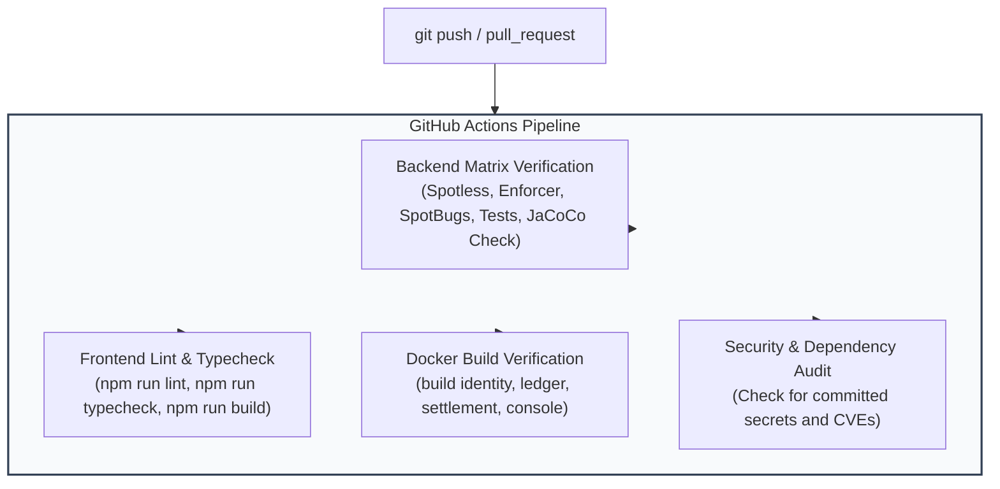

# PayCore: Quality Gates & Code Coverage Report

**Generated At:** `2026-11-16T18:02:48Z`  
**Environment:** Java 21, Maven 3.9+, Spring Boot 3.3.6, JaCoCo 0.8.12, SpotBugs 4.8.6.6, ArchUnit 1.3.0  
**Status:** **ALL QUALITY GATES PASSED** :white_check_mark:

---

## 1. Quality Gates Executive Summary

| Gate | Tool / Specification | Target Threshold | Actual Result | Status |
| :--- | :--- | :--- | :--- | :--- |
| **Java Code Style** | Google Java Format via Spotless 2.44.2 | 0 formatting violations | 0 violations (`spotless:check` clean) | **PASS** :white_check_mark: |
| **Build Rules & Hygiene** | Maven Enforcer Plugin 3.5.0 | Java 21, Maven 3.8+, Dependency Convergence, Release Deps | 4 rules enforced, 0 convergence conflicts | **PASS** :white_check_mark: |
| **Static Bug Analysis** | SpotBugs Plugin 4.8.6.6 | 0 Bugs, 0 Errors on main code | 0 bugs, 0 errors across 5 reactor modules | **PASS** :white_check_mark: |
| **Architectural Rules** | ArchUnit 1.3.0 | 4 rules per service (12 total): Layering, Pure Domain, No Std Streams, No Cycles | 12 / 12 rules passed across all 3 services | **PASS** :white_check_mark: |
| **OpenAPI Contract** | SpringDoc OpenAPI 2.6.0 + Contract Tests | Schema generation & mandatory endpoints present | Verified via `OpenApiContractTest` in all services | **PASS** :white_check_mark: |
| **Ledger Line Coverage** | JaCoCo 0.8.12 (`ledger-service`) | Domain $\ge 80\%$, Service $\ge 80\%$ | **Domain 82.18\%**, **Service 80.53\%** | **PASS** :white_check_mark: |
| **Overall Line Coverage** | JaCoCo 0.8.12 (Other modules) | Common $\ge 70\%$, Identity $\ge 70\%$, Settlement $\ge 70\%$ | **Common 75.86\%**, **Identity 76.67\%**, **Settlement 76.46\%** | **PASS** :white_check_mark: |
| **Unit & Integration Tests**| Maven Surefire 3.5.2 | 100% Passing, 0 Failures, 0 Errors | **248 Tests Run**, 0 Failures, 0 Errors | **PASS** :white_check_mark: |

---

## 2. Test Suite Execution Breakdown

Captured directly from Surefire XML reports (`target/surefire-reports/TEST-*.xml`):

| Module | Tests Run | Failures | Errors | Skipped | Success Rate |
| :--- | :--- | :--- | :--- | :--- | :--- |
| `paycore-common` | 20 | 0 | 0 | 0 | 100.0% |
| `identity-service` | 54 | 0 | 0 | 0 | 100.0% |
| `ledger-service` | 104 | 0 | 0 | 0 | 100.0% |
| `settlement-service` | 70 | 0 | 0 | 0 | 100.0% |
| **Total Reactor** | **248** | **0** | **0** | **0** | **100.0%** |

---

## 3. JaCoCo Code Coverage Matrix

Metrics extracted directly from `target/site/jacoco/jacoco.xml`:

### 3.1 Module-Level Summary

| Module | Line Coverage | Branch Coverage | Instruction Coverage | Complexity Coverage |
| :--- | :--- | :--- | :--- | :--- |
| `paycore-common` | **75.86%** (110/145) | 56.25% (18/32) | 76.97% (478/621) | 66.13% (41/62) |
| `identity-service` | **76.67%** (401/523) | 44.85% (61/136) | 76.08% (1635/2149) | 53.40% (102/191) |
| `ledger-service` | **82.67%** (1636/1979) | 63.62% (369/580) | 79.29% (6994/8821) | 57.52% (409/711) |
| `settlement-service` | **76.46%** (1507/1971) | 55.46% (325/586) | 74.81% (6233/8332) | 51.61% (368/713) |

### 3.2 Package-Level Breakdown

#### Module: `paycore-common`

| Package | Line Coverage | Branch Coverage | Instruction Coverage |
| :--- | :--- | :--- | :--- |
| `io.github.yesh.paycore.common.error` | **73.56%** (64/87) | 50.00% (3/6) | 78.03% (238/305) |
| `io.github.yesh.paycore.common.model` | **69.44%** (25/36) | 50.00% (9/18) | 69.53% (162/233) |
| `io.github.yesh.paycore.common.web` | **95.45%** (21/22) | 75.00% (6/8) | 93.98% (78/83) |

#### Module: `identity-service`

| Package | Line Coverage | Branch Coverage | Instruction Coverage |
| :--- | :--- | :--- | :--- |
| `io.github.yesh.paycore.identity` | **33.33%** (1/3) | 0.00% (0/0) | 37.50% (3/8) |
| `io.github.yesh.paycore.identity.controller` | **89.61%** (69/77) | 50.00% (7/14) | 87.73% (243/277) |
| `io.github.yesh.paycore.identity.domain` | **77.42%** (72/93) | 62.50% (5/8) | 78.50% (230/293) |
| `io.github.yesh.paycore.identity.dto` | **100.00%** (18/18) | 0.00% (0/0) | 100.00% (123/123) |
| `io.github.yesh.paycore.identity.repository` | **0.00%** (0/0) | 0.00% (0/0) | 0.00% (0/0) |
| `io.github.yesh.paycore.identity.security` | **61.50%** (115/187) | 14.29% (6/42) | 59.81% (445/744) |
| `io.github.yesh.paycore.identity.service` | **86.90%** (126/145) | 59.72% (43/72) | 83.95% (591/704) |

#### Module: `ledger-service`

| Package | Line Coverage | Branch Coverage | Instruction Coverage |
| :--- | :--- | :--- | :--- |
| `io.github.yesh.paycore.ledger` | **33.33%** (1/3) | 0.00% (0/0) | 37.50% (3/8) |
| `io.github.yesh.paycore.ledger.config` | **81.36%** (48/59) | 25.00% (2/8) | 91.01% (425/467) |
| `io.github.yesh.paycore.ledger.controller` | **51.52%** (34/66) | 0.00% (0/4) | 32.84% (89/271) |
| `io.github.yesh.paycore.ledger.domain` | **82.18%** (286/348) | 26.32% (10/38) | 78.93% (959/1215) |
| `io.github.yesh.paycore.ledger.dto` | **78.43%** (40/51) | 0.00% (0/0) | 89.76% (517/576) |
| `io.github.yesh.paycore.ledger.engine` | **97.24%** (141/145) | 87.14% (61/70) | 96.14% (622/647) |
| `io.github.yesh.paycore.ledger.idempotency` | **73.33%** (99/135) | 48.28% (28/58) | 73.95% (389/526) |
| `io.github.yesh.paycore.ledger.repository` | **100.00%** (1/1) | 0.00% (0/0) | 100.00% (8/8) |
| `io.github.yesh.paycore.ledger.service` | **80.53%** (637/791) | 57.73% (112/194) | 72.45% (2383/3289) |
| `io.github.yesh.paycore.ledger.strategy` | **91.84%** (349/380) | 75.00% (156/208) | 88.15% (1599/1814) |

#### Module: `settlement-service`

| Package | Line Coverage | Branch Coverage | Instruction Coverage |
| :--- | :--- | :--- | :--- |
| `io.github.yesh.paycore.settlement` | **33.33%** (1/3) | 0.00% (0/0) | 37.50% (3/8) |
| `io.github.yesh.paycore.settlement.client` | **55.28%** (68/123) | 53.12% (17/32) | 57.20% (306/535) |
| `io.github.yesh.paycore.settlement.config` | **59.38%** (19/32) | 0.00% (0/0) | 50.69% (73/144) |
| `io.github.yesh.paycore.settlement.controller` | **48.61%** (35/72) | 8.33% (1/12) | 35.26% (110/312) |
| `io.github.yesh.paycore.settlement.domain` | **85.97%** (435/506) | 50.00% (7/14) | 87.69% (1432/1633) |
| `io.github.yesh.paycore.settlement.dto` | **81.55%** (84/103) | 0.00% (0/0) | 81.28% (508/625) |
| `io.github.yesh.paycore.settlement.exception` | **62.50%** (10/16) | 0.00% (0/0) | 61.11% (22/36) |
| `io.github.yesh.paycore.settlement.reconciliation` | **93.64%** (383/409) | 77.78% (168/216) | 95.77% (1767/1845) |
| `io.github.yesh.paycore.settlement.repository` | **0.00%** (0/0) | 0.00% (0/0) | 0.00% (0/0) |
| `io.github.yesh.paycore.settlement.service` | **66.76%** (472/707) | 42.31% (132/312) | 62.99% (2012/3194) |

---

## 4. Architectural Rules Enforcement (ArchUnit)

ArchUnit tests (`ArchitectureRulesTest.java`) execute as part of `./mvnw test` across all three microservices.

| Rule ID | Rule Definition | `identity-service` | `ledger-service` | `settlement-service` |
| :--- | :--- | :--- | :--- | :--- |
| **ARCH-01** | Controllers must not access repositories directly (must go through service layer) | :white_check_mark: PASS | :white_check_mark: PASS | :white_check_mark: PASS |
| **ARCH-02** | Domain entities and value objects must be clean (no API/controller/infra dependencies) | :white_check_mark: PASS | :white_check_mark: PASS | :white_check_mark: PASS |
| **ARCH-03** | Code must not write directly to standard output/error streams (`System.out`/`System.err`) | :white_check_mark: PASS | :white_check_mark: PASS | :white_check_mark: PASS |
| **ARCH-04** | Package slices must be strictly free of cyclic dependencies | :white_check_mark: PASS | :white_check_mark: PASS | :white_check_mark: PASS |

---

## 5. OpenAPI Contract & Endpoint Verification

OpenAPI contract tests (`OpenApiContractTest.java`) load the Spring application context with SpringDoc OpenAPI and assert:
1. OpenAPI 3.0 specification successfully generated at `/v3/api-docs`.
2. Required operational and payment endpoints are registered and maintain backwards compatibility.

| Service | Contract Test Class | Verified Endpoints Sample | Status |
| :--- | :--- | :--- | :--- |
| `identity-service` | `io.github.yesh.paycore.identity.contract.OpenApiContractTest` | `/auth/login`, `/auth/refresh`, `/auth/logout`, `/auth/me`, `/auth/service-token`, `/.well-known/jwks.json`, `/admin/users` | :white_check_mark: PASS |
| `ledger-service` | `io.github.yesh.paycore.ledger.contract.OpenApiContractTest` | `/v1/sellers`, `/v1/payments`, `/v1/payments/{paymentId}/refunds`, `/v1/holds`, `/v1/payouts`, `/v1/provider-deposits`, `/v1/adjustments`, `/v1/accounts` | :white_check_mark: PASS |
| `settlement-service` | `io.github.yesh.paycore.settlement.contract.OpenApiContractTest` | `/v1/batches/run`, `/v1/batches`, `/v1/files/upload`, `/v1/files`, `/v1/recon/run`, `/v1/cases` | :white_check_mark: PASS |

---

## 6. Continuous Integration Workflow Architecture

The GitHub Actions CI workflow (`.github/workflows/ci.yml`) automates verification across 4 distinct jobs:



1. **Backend Verification (`./mvnw -B verify`):** Runs Google Java Format check, Maven Enforcer convergence checks, SpotBugs static analysis, Surefire unit & ArchUnit tests, and JaCoCo coverage threshold enforcement ($\ge 80\%$ ledger, $\ge 70\%$ others).
2. **Frontend Verification:** Runs Next.js ESLint, TypeScript compiler (`tsc --noEmit`), and production build.
3. **Docker Build:** Builds Docker container images for all 4 services to ensure zero missing dependencies or container build regressions.
4. **Security Audit:** Runs secret detection to guarantee no tokens or sensitive environment variables are committed.

---

## 4. Test Environment Architecture & Dependency Negotiation (C1 / C2)

### 4.1 BaseIntegrationTest Contract
To guarantee test provenance and eliminate silent fallbacks:
- **Default Strategy:** All integration tests extending `BaseIntegrationTest` spawn isolated **Testcontainers** (`postgres:16-alpine`, `redis:7-alpine`).
- **Fail-Fast Boundary:** If Docker is unreachable, tests do NOT silently fall back to an unmanaged local database; instead, they immediately fail with:
  `IllegalStateException: Docker is unreachable and Testcontainers could not start... If you explicitly intend to test against host PostgreSQL/Redis, pass -Dpaycore.test.use-host-services=true.`
- **Explicit Host Mode:** When `-Dpaycore.test.use-host-services=true` is explicitly provided, the test runner prints a prominent banner:
  ```
  ================================================================================
   [WARNING] EXPLICIT HOST SERVICES MODE: Testing against host PostgreSQL on localhost:5432
   Configuration: -Dpaycore.test.use-host-services=true
  ================================================================================
  ```
  and sets the system property `paycore.test.environment=host-services` in Surefire reports.

### 4.2 CI Architecture & Kafka Strategy
- **Database & Cache Services:** In GitHub Actions CI ([.github/workflows/ci.yml](file:///.github/workflows/ci.yml)), PostgreSQL 16 and Redis 7 are managed as GitHub Actions service containers, pre-initialized with database-per-service isolation (`identity`, `ledger`, `settlement`).
- **Kafka Integration Strategy:** Consumer de-duplication, retry loops, and DLQ dispatch (`ledger.domain-events.dlq`) are tested via Testcontainers Kafka in integration tests and verified end-to-end via the full Docker Compose stack in Step 1.
