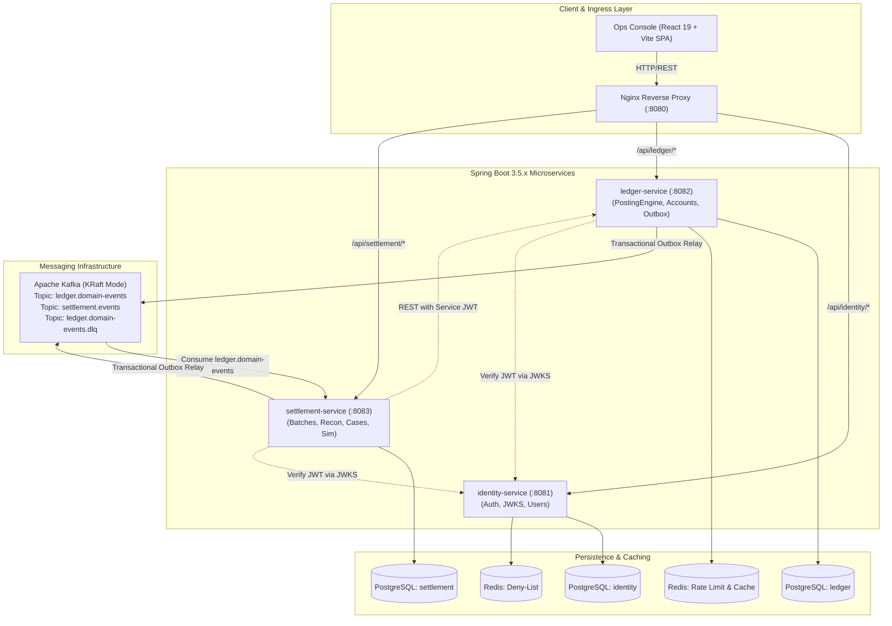
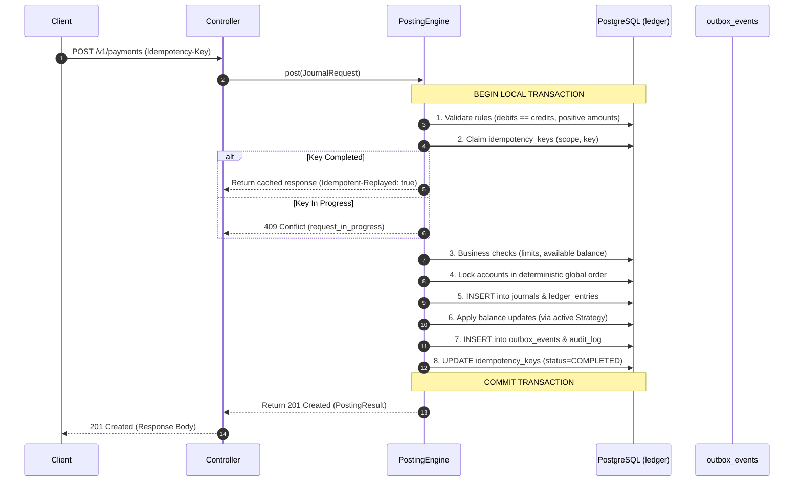
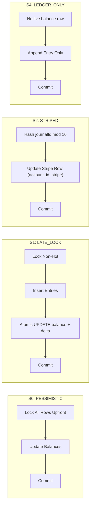
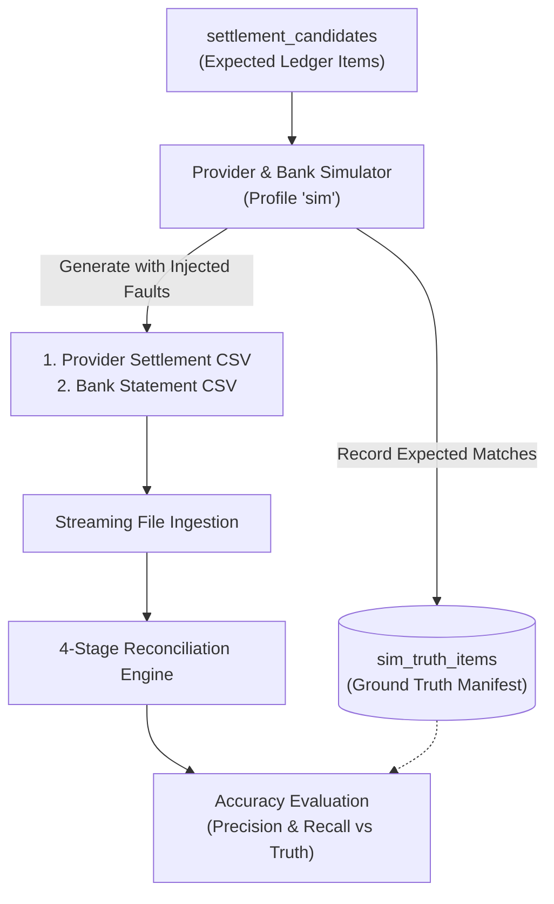
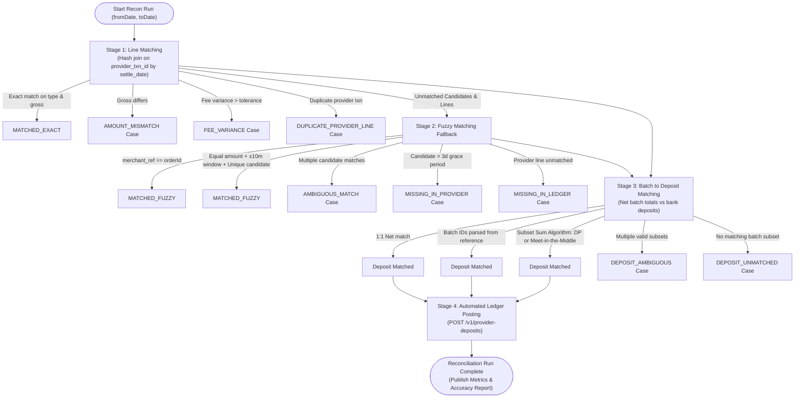
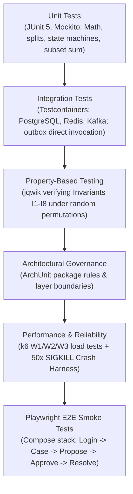
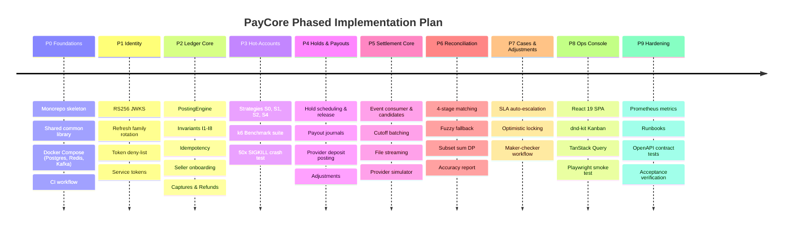

# PayCore System Design & Architecture Specification

*Prepared for Atmakuri Yeshwanth. Single Source of Truth for System Architecture, Data Contracts, and Implementation Execution.*

---

## 1. Executive Summary & System Scope

### 1.1 Problem Space
In multi-sided marketplace platforms, the core financial pipeline processes buyer payments, deducts platform commission fees, and batches payouts to sellers. Production platforms encounter three critical failure modes:
1. **Hot-Account Contention:** Balances become a transactional bottleneck because every incoming payment updates a small number of shared system accounts (e.g., `PLATFORM_FEE_REVENUE` and `PROVIDER_RECEIVABLE`), serializing database row locks and collapsing throughput under concurrency.
2. **Reconciliation Complexity:** Payment providers deposit funds into company bank accounts in bulk (covering thousands of orders minus transaction fees, refunds, and reserves). Manual reconciliation across disparate bank statements and settlement files is slow and prone to errors.
3. **Unmanaged Financial Discrepancies:** Mismatches, missing settlements, and fee variances typically get relegated to unowned spreadsheets with no service-level agreements (SLAs), clear audit trails, or enforceable resolution deadlines.

### 1.2 System Mission
**PayCore** is a high-throughput, fault-tolerant, double-entry financial ledger and settlement platform written in Java 21 and Spring Boot 3.5.x. PayCore:
- Records all money movement via immutable, balanced double-entry journals.
- Solves hot-account contention through comparative benchmarking of isolated balance strategies.
- Automates settlement batching, bank payout generation, and provider file ingestion.
- Reconciles many-to-one settlements and bank deposits with mathematical precision and explainable matching stages.
- Operates a case management engine with automated SLA escalation and maker-checker adjustment workflows.

### 1.3 Personas & RBAC Claims

| Persona | Role Claim | Scope & Permissions |
| :--- | :--- | :--- |
| **Merchant** (Seller) | `MERCHANT` | Scoped strictly to their own `sellerId`. Views balances (available, held, in-transit), holds with release schedules, payout history, and account statements. |
| **Ops Analyst** | `ANALYST` | Operations view across all sellers. Runs reconciliation workflows, triages exceptions and cases, creates comments, transitions cases, and proposes financial adjustments. |
| **Admin** | `ADMIN` | Superuser privileges. Manages platform users and roles, approves/rejects financial adjustments (maker-checker enforcement), triggers settlement batches, and inspects system integrity. |
| **Service** | `SERVICE` | Machine identity (m2m authentication via Client Credentials). Executes automated batches, posts payouts, records provider deposits, and posts approved adjustments to the ledger. |

### 1.4 System Goals vs. Non-Goals

#### Core Goals
- **G1: Correct Money Movement:** Idempotent, balanced, auditable, crash-resilient double-entry accounting.
- **G2: Hot-Account Scalability:** Implement and benchmark multiple hot-account strategies (`PESSIMISTIC`, `LATE_LOCK`, `STRIPED`, `LEDGER_ONLY`, and optional `BATCHED`), proving higher throughput under concurrency.
- **G3: Automated Settlement:** Candidate aggregation, cutoff batching, idempotent bank payout dispatch, and provider file streaming ingestion.
- **G4: Explainable Reconciliation:** Multi-stage reconciliation (line match, fuzzy matching, dynamic programming subset search for batched deposits) producing precision/recall metrics.
- **G5: Exception Operations:** SLA-backed case lifecycle, automated per-minute escalation, and dual-control maker-checker adjustments.
- **G6: Production Engineering:** RS256 JWT with refresh rotation, outbox event streaming via Kafka, Prometheus metrics, structured JSON logging, ArchUnit testing, and Docker Compose deployment.

#### Non-Goals (Out of Scope for v1)
- Connecting to live banking rails, handling raw credit card data, or PCI-DSS certification scope.
- Multi-currency or foreign exchange (FX) conversion. (All v1 transactions are in `INR`; minor unit: paise).
- Kubernetes, service mesh (Istio/Linkerd), multi-region replication, or external schema registries.
- AI/LLM integrations: PayCore is strictly focused on deterministic systems and financial engineering.

### 1.5 Demonstrable Success Criteria
- **S1:** Property-based and concurrency tests demonstrate debits equal credits under arbitrary operation sequences.
- **S2:** Crash recovery harness (50 iterations of `SIGKILL` mid-load) verifies zero invariant violations and outbox consistency upon restart.
- **S3:** Benchmark report in `docs/benchmark-report.md` compares at least 3 hot-account strategies on identical hardware and workloads.
- **S4:** Synthetic reconciliation test suite processes seeded fault files and outputs precision/recall reports per rule.
- **S5:** Single command `docker compose --profile core up --build` boots all services; ops console operates end-to-end.
- **S6:** CI pipeline executes format verification, unit tests, integration tests via Testcontainers, and enforces JaCoCo coverage gates (≥80% on ledger domain/service, ≥70% on others).

---

## 2. Domain & Double-Entry Accounting Architecture

### 2.1 Money Representation & Calculation Rules
- **Minor Units Only:** All monetary amounts are handled as `long` integers in Java and `BIGINT` in PostgreSQL representing paise ($1\text{ INR} = 100\text{ paise}$). Floating-point types (`float`, `double`, `BigDecimal`) are strictly prohibited in the core execution path to eliminate precision drift.
- **Value Object:** Shared `Money(long amount, String currency)` record enforces immutability and guards against negative amounts where prohibited.
- **Currency:** v1 exclusively supports `"INR"`. Every write request validates currency code equality.
- **Temporal Standard:** All timestamps use UTC (`timestamptz`). Domain components receive an injectable `java.time.Clock` instance.
- **Fee Calculation & Remainder Allocation:**
  To guarantee exact journal balance without rounding loss:
  $$\text{gross} = \text{input amount}$$
  $$\text{fee} = \text{round\_half\_up}\left(\frac{\text{gross} \times \text{feeBps}}{10000}\right)$$
  $$\text{sellerShare} = \text{gross} - \text{fee}$$
  The seller always receives the exact remainder: $\text{fee} + \text{sellerShare} = \text{gross}$.

### 2.2 Chart of Accounts
Balances are derived based on each account's **Normal Side**:
$$\text{Balance}_{\text{DEBIT normal}} = \sum \text{Debits} - \sum \text{Credits}$$
$$\text{Balance}_{\text{CREDIT normal}} = \sum \text{Credits} - \sum \text{Debits}$$

| Account Code | Scope | Type | Normal Side | Hot Account? | Domain Meaning |
| :--- | :--- | :--- | :--- | :--- | :--- |
| `PROVIDER_RECEIVABLE` | System (Singleton) | ASSET | DEBIT | **Yes** | Funds collected and owed by payment provider to the platform. |
| `BANK_CASH` | System (Singleton) | ASSET | DEBIT | No | Platform main bank checking account balance. |
| `PAYOUT_IN_TRANSIT` | System (Singleton) | LIABILITY | CREDIT | No | Payouts issued to sellers but awaiting bank clearance. |
| `PLATFORM_FEE_REVENUE` | System (Singleton) | REVENUE | CREDIT | **Yes** | Net platform revenue accumulated from commission fees. |
| `PROVIDER_FEE_EXPENSE` | System (Singleton) | EXPENSE | DEBIT | No | Transaction and processing fees charged by the payment gateway. |
| `WRITE_OFF_EXPENSE` | System (Singleton) | EXPENSE | DEBIT | No | Unrecoverable settlement discrepancies written off by Admin. |
| `SELLER_PAYABLE` | Per Seller (`sellerId`) | LIABILITY | CREDIT | No | Unencumbered funds owed to the seller, available for payout. |
| `SELLER_HELD` | Per Seller (`sellerId`) | LIABILITY | CREDIT | No | Seller funds under rolling reserve hold or dispute lock. |

### 2.3 Journal Posting Templates

Every operational event creates a single balanced journal with at least two entry lines.

```
Notation:
G = Gross Amount
F = Fee Amount
S = Seller Share (G - F)
H = Held Amount: round_half_up(S * holdBps / 10000)
R = Refund Gross Amount
S_r = Seller Refund Portion: round_half_up(R * S / G)
F_r = Fee Refund Portion: R - S_r
P = Payout Amount
D = Deposit Net Amount
E = Provider Expense Fee Amount
X = Discrepancy / Adjustment Amount
```

| Operation | Debit Account(s) & Amount | Credit Account(s) & Amount | Invariant Guarantees |
| :--- | :--- | :--- | :--- |
| **Payment Capture (No Hold)** | `PROVIDER_RECEIVABLE`: $G$ | `SELLER_PAYABLE`: $S$<br>`PLATFORM_FEE_REVENUE`: $F$ | $G = S + F$ |
| **Payment Capture (With Hold)** | `PROVIDER_RECEIVABLE`: $G$ | `SELLER_PAYABLE`: $S - H$<br>`SELLER_HELD`: $H$<br>`PLATFORM_FEE_REVENUE`: $F$ | $G = (S - H) + H + F$ |
| **Place Manual Hold** | `SELLER_PAYABLE`: $H$ | `SELLER_HELD`: $H$ | Seller available balance reduced |
| **Release Hold** | `SELLER_HELD`: $H$ | `SELLER_PAYABLE`: $H$ | Seller available balance restored |
| **Proportional Refund** | `SELLER_PAYABLE`: $S_r$<br>`PLATFORM_FEE_REVENUE`: $F_r$ | `PROVIDER_RECEIVABLE`: $R$ | $S_r + F_r = R$. `SELLER_PAYABLE` may go negative. |
| **Payout Requested** | `SELLER_PAYABLE`: $P$ | `PAYOUT_IN_TRANSIT`: $P$ | Requires $P \le \text{Available } \text{SELLER\_PAYABLE}$ |
| **Payout Confirmed** | `PAYOUT_IN_TRANSIT`: $P$ | `BANK_CASH`: $P$ | Liability settled against bank cash |
| **Payout Failed** | `PAYOUT_IN_TRANSIT`: $P$ | `SELLER_PAYABLE`: $P$ | Liability restored to seller |
| **Provider Deposit** | `BANK_CASH`: $D$<br>`PROVIDER_FEE_EXPENSE`: $E$ | `PROVIDER_RECEIVABLE`: $D + E$ | Clears receivable against actual bank cash |
| **Fee Variance Adjustment**| `PROVIDER_FEE_EXPENSE`: $X$ | `PROVIDER_RECEIVABLE`: $X$ | Aligns fee discrepancy |
| **Write-Off Adjustment** | `WRITE_OFF_EXPENSE`: $X$ | `PROVIDER_RECEIVABLE`: $X$ | Writes off uncollectible provider receivable |

### 2.4 Core Ledger Invariants (I1 - I8)

| Invariant | Definition | Automated Verification Mechanism |
| :--- | :--- | :--- |
| **I1: Zero-Sum Balance** | Every journal contains $\ge 2$ entries, all amounts $> 0$, and $\sum \text{Debits} = \sum \text{Credits}$. | Domain validator in `PostingEngine.post()`; jqwik property test. |
| **I2: Ledger Immutability** | Entries and journals are strictly append-only. No `UPDATE` or `DELETE` is permitted. | PostgreSQL trigger `trg_prevent_entry_modification` raises exception on update/delete. |
| **I3: Global Conservation** | Across the entire database, $\sum_{\text{all entries}} \text{Debits} = \sum_{\text{all entries}} \text{Credits}$. | Scheduled integrity job (`IntegrityChecker`) queries global sum; exposed via `/v1/integrity`. |
| **I4: Balance Consistency** | Account cached balance equals sum of its entries (or sum of stripes in S2, or snapshot + delta in S4). | Verified by nightly `IntegrityChecker` across all account IDs. |
| **I5: No Payout Overdraft** | Payout requests cannot exceed available `SELLER_PAYABLE`. Balance may go negative only via refunds/disputes. | Row-level pessimistic lock on `SELLER_PAYABLE` checks balance before posting payout journal. |
| **I6: Idempotent Posting** | An `Idempotency-Key` within a scope results in at most one journal posting. | Unique constraint on `(scope, key)` in `idempotency_keys`; concurrency stress tests. |
| **I7: Refund Ceiling** | Cumulative refunds for a payment must never exceed the captured gross amount ($\sum R \le G$). | Atomic validation in payment refund transaction checking `refunded_total + amount <= gross`. |
| **I8: Unique Business Link** | Each journal links to exactly one business operation reference (`operation_type`, `operation_ref`). | Database unique constraint `uk_journal_operation` on `(operation_type, operation_ref)`. |

---

## 3. High-Level Architecture & Infrastructure Topology



### 3.1 Network Port Mapping & Routing
- `ops-console` (Nginx): `http://localhost:8080`
  - Routes `/api/identity/*` $\to$ `identity-service:8081`
  - Routes `/api/ledger/*` $\to$ `ledger-service:8082`
  - Routes `/api/settlement/*` $\to$ `settlement-service:8083`
  - Serves static assets, index.html SPA fallback, and security headers.
- `identity-service`: Internal port `8081` (Actuator on `9081`)
- `ledger-service`: Internal port `8082` (Actuator on `9082`)
- `settlement-service`: Internal port `8083` (Actuator on `9083`)
- `PostgreSQL 16`: Port `5432` (Hosts databases `identity`, `ledger`, `settlement`)
- `Redis 7`: Port `6379`
- `Kafka (KRaft)`: Port `9092`

### 3.2 Architectural Principles
1. **Strict Data Isolation:** Each service exclusively owns its schema. Cross-database queries or foreign keys between service databases are strictly prohibited.
2. **Commands vs. Events:**
   - Synchronous REST: Used for commands requiring immediate transactional confirmation (e.g., capture payment, request payout).
   - Asynchronous Events: Used for state notifications and read-model population (e.g., candidate aggregation in settlement).
3. **Transactional Outbox Pattern:**
   - Producers write domain events to an `outbox_events` table inside the exact same local database transaction as the business operation.
   - An independent asynchronous poller claims unpublished outbox rows using `SELECT ... FOR UPDATE SKIP LOCKED`, dispatches to Kafka, and marks them published upon acknowledgement.
4. **Failure Isolation:**
   - If Kafka fails, payment capture continues uninterrupted; outbox events accumulate safely in the database.
   - If settlement-service is offline, ledger continues processing; events queue in Kafka.
   - If Redis fails, rate limiting fails closed by default (configurable), while token deny-list validation fails open with logged warnings and metric increments.

---

## 4. Code Reuse Manifest & Source Adaptation Plan

Per Playbook Section 6, only verified MIT-licensed repositories are utilized. All code is scrubbed of original package names and vendor branding.

### 4.1 Source A: `Dedmoo/RetailBankingCore` (MIT)
**Target:** `services/ledger-service` and `libs/paycore-common`

| Module / Component | What to Pull & Reuse | What to Adapt / Rewrite | What to Delete Entirely |
| :--- | :--- | :--- | :--- |
| `messaging/` | Outbox entity, poller relay, `SKIP LOCKED` SQL, publisher. | Rename target topic to `ledger.domain-events`; adapt payload to PayCore event envelope. | `DomainEventLoggingConsumer` (demo artifact). |
| `ratelimit/` | Redis Lua token bucket script and filter. | Enforce on `/v1/payments`, `/v1/refunds`, `/v1/payouts`; key by token subject. | Per-user retail account logic. |
| `transfer/` | Concurrency lock order pattern (lower ID first), idempotency handling. | Replace single transfer concept with full multi-line `PostingEngine` and journal templates. | Retail "HOUSE" account concepts, "transfer reverse" naming. |
| `account/`, `audit/` | Account entity structure, audit trail pattern. | Implement Chart of Accounts (Section 2.2); enforce immutable SQL triggers (I2). | Retail freeze/unfreeze/close account workflows. |
| `common/`, `config/` | Correlation ID filter, base exception handler, security headers. | Move reusable items to `libs/paycore-common`. | Retail-specific exceptions. |
| `security/` | SecurityFilterChain skeleton. | Replace symmetric HS256 with RS256 Nimbus reactive/servlet JWKS validator. | Embedded token issuer. |
| `auth/`, `user/` | None. | Completely deleted. Identity logic is delegated to `identity-service`. | All user and login classes. |
| Flyway Migrations | Reference structure only. | Write fresh migrations matching PayCore schema specifications (Section 6). | Original V1-V5 migration scripts and seed credentials. |

### 4.2 Source B: `Gabrielab5/IssuesFlow` (MIT)
**Targets:** `web/ops-console`, `services/identity-service`, `settlement-service` escalation

| Module / Component | What to Pull & Reuse | What to Adapt / Rewrite | What to Delete Entirely |
| :--- | :--- | :--- | :--- |
| `frontend/` UI App Shell | Vite/React 19 structure, Tailwind config, `AuthProvider`, `ProtectedRoute`, Axios client with interceptors, Layout, Card, Button, Badge. | Build PayCore pages: Dashboard, Cases, Recon, Ledger, Payouts, Admin. Store access token in memory; refresh in cookie. | Mentions UI, attachments UI, ticket dependency graph, Jira/Atlassian branding. |
| UI Kanban & Charts | `@dnd-kit` Kanban board, Recharts status distributions. | Re-target Kanban to Case states (`OPEN`, `IN_REVIEW`, `ESCALATED`, `RESOLVED`, `WRITTEN_OFF`). Optimistic update with rollback. | Animated background, task time tracking. |
| Identity Backend | `JwtService`, `TokenDenyListService`, `AuthService`, `AuditService`. | Switch to RS256 with dual-key JWKS endpoint; implement refresh token family rotation; add Service Tokens. | HS256 shared secret logic, hard-coded `admin123` seed users. |
| Escalation Engine | Scheduled escalation background job, optimistic locking pattern (`@Version`). | Reimplement inside `settlement-service` for Case SLA management (Section 5.4). | Ticket workload auto-assigner, soft-delete restore flows. |
| Infrastructure | Dockerfile, Nginx configuration templates. | Configure Nginx reverse proxy routes for `/api/identity`, `/api/ledger`, `/api/settlement`. | Legacy deployment scripts. |

### 4.3 Pull Procedure & Licensing Compliance
1. Clone source repos into isolated `/tmp/` staging directory. Inspect and verify LICENSE files.
2. Copy permissible modules into target PayCore directories.
3. Rename base packages from external names to `io.github.<owner>.paycore.*`.
4. Delete all deprecated and unused classes as documented above.
5. Record entries in `THIRD_PARTY_NOTICES.md` detailing: Repository URL, commit SHA, MIT license text, copied files, and their new locations.

---

## 5. Service Deep Dives & Engineering Specifications

### 5.1 Identity Service (`identity-service`)

#### 5.1.1 Core Responsibilities & Features
The Identity Service is the sole authority managing credentials and minting tokens. All other services act strictly as OAuth2 Resource Servers.

| Feature ID | Endpoint / Mechanism | Architectural Specification |
| :--- | :--- | :--- |
| **F-I-01** | `POST /auth/login` | Authenticates username + password via BCrypt (cost factor 12). Returns access token in response body. Sets refresh token as `httpOnly`, `Secure`, `SameSite=Strict` cookie scoped to `/api/identity/auth`. Generic error returned on failure to prevent user enumeration. |
| **F-I-02** | `POST /auth/refresh` | Validates refresh token from cookie. Implements **Refresh Token Family Rotation**: the supplied token is marked used; a new token in the same `family_id` is issued. If an already-used token is presented (replay attack), the entire family is immediately revoked, an audit record is written, and `401 Unauthorized` is returned. |
| **F-I-03** | `POST /auth/logout` | Revokes the current refresh token family, clears the refresh cookie, and writes the access token's `jti` to the Redis deny-list with TTL equal to its remaining validity period. |
| **F-I-04** | `GET /auth/me` | Returns caller identity: `userId`, `username`, `roles[]`, and `sellerId` (if role includes `MERCHANT`). |
| **F-I-05** | `GET /.well-known/jwks.json` | Public JWKS endpoint exposing active public keys. Supports dual keys (`current` and `previous` key IDs) allowing seamless cryptographic key rotation without downtime. |
| **F-I-06** | `POST /auth/service-token` | Machine-to-machine client authentication via `client_id` and `client_secret` (BCrypt verified against `service_clients`). Issues JWT with role `SERVICE` and 10-minute validity. Clients cache tokens until 60 seconds before expiration. |
| **F-I-07** | User Administration | Admin endpoints (`GET /admin/users`, `POST /admin/users`, `PATCH /admin/users/{id}`). Allows user provisioning and role assignment. Guard: an admin cannot disable or demote themselves. |
| **F-I-08** | Brute-Force Defense | Redis token bucket rate limits per IP and per username. Five consecutive failed login attempts lock the username for 15 minutes. Responses for locked users match invalid password responses. |
| **F-I-09** | Identity Audit Log | Append-only audit logging of all authentication events: login success/failure, logout, token family revocation, role modifications, and account disabling. |

#### 5.1.2 Token Design & Claims
- **Algorithm:** RS256 (RSA Signature with SHA-256). 2048-bit RSA key pair.
- **Access Token Lifetime:** 15 minutes.
- **Access Token Claims:**
  ```json
  {
    "sub": "usr_9b1deb4d-3b7d-4bad-9bdd-2b0d7b3dcb6d",
    "iss": "paycore-identity",
    "aud": "paycore",
    "roles": ["MERCHANT"],
    "sellerId": "sel_01HXYZ1234567890",
    "jti": "jwt_f47ac10b-58cc-4372-a567-0e02b2c3d479",
    "iat": 1731672000,
    "exp": 1731672900
  }
  ```
- **Refresh Token:** Cryptographically secure 256-bit random entropy. Stored in database strictly as a SHA-256 hash. Validity: 7 days.
- **Resource Server Validation & Deny-List Fallback (ADR Decision):**
  Resource servers validate signatures via `jwk-set-uri`. Custom `JwtAuthenticationConverter` extracts `roles` into Spring Security granted authorities (`ROLE_*`). A custom validator checks Redis for token `jti` deny-listing. If Redis is down, the deny-list check is skipped, metric `denylist_check_skipped_total` increments, a warning is logged, and the request succeeds based on cryptographic signature validity alone.

---

### 5.2 Ledger Service & Posting Engine (`ledger-service`)

#### 5.2.1 Transactional Posting Engine (`PostingEngine.post`)
Every financial modification in PayCore flows through a single transactional method:
`PostingResult PostingEngine.post(JournalRequest request)`



**Implementation Rules:**
- Database interactions in steps 4 to 7 use Spring `JdbcClient` with explicit SQL statements for deterministic execution and index optimization.
- Transactions are kept sub-millisecond. **No network calls** (Kafka, Redis, HTTP) are permitted inside the transaction boundary.

#### 5.2.2 Global Lock Ordering Protocol
To eliminate all possibility of distributed or database deadlocks, accounts are locked in a deterministic global order across all operations:
1. **Tier 1 (Non-Hot Accounts):** Locked first, ordered strictly by `account_id` ascending.
2. **Tier 2 (Hot Accounts):** Locked second, ordered strictly by `account_id` ascending.

#### 5.2.3 Idempotency Framework (F-L-10)
- **Header:** Required `Idempotency-Key` (8 to 64 ASCII characters) on all mutating endpoints.
- **Request Hash:** SHA-256 hash computed over `(HTTP Method + Path + Request Body)`.
- **Database Table:** `idempotency_keys` with unique index on `(scope, key)`. `scope` is derived from the authenticated caller's identity (`sub`).
- **Resolution Matrix:**
  - *Same scope, same key, same hash, status COMPLETED:* Return stored response with `Idempotent-Replayed: true`. No journal or event is created.
  - *Same scope, same key, different hash:* Abort with `422 Unprocessable Entity (idempotency_key_reused)`.
  - *Same scope, same key, status IN_PROGRESS:* Abort with `409 Conflict (request_in_progress)`.
- **Retention:** Scheduled daily job purges completed records older than 7 days.

#### 5.2.4 Ledger Service Feature Specifications

| Feature ID | Endpoint / Job | Scope & Invariants |
| :--- | :--- | :--- |
| **F-L-01** | `POST /v1/sellers` | Onboards seller. Atomically creates seller record and initializes `SELLER_PAYABLE` and `SELLER_HELD` accounts. Idempotent by `sellerId`. |
| **F-L-02** | `POST /v1/payments` | Payment capture. Computes fee and seller split. Posts journal: Debit `PROVIDER_RECEIVABLE` ($G$); Credit `SELLER_PAYABLE` ($S-H$); Credit `SELLER_HELD` ($H$); Credit `PLATFORM_FEE_REVENUE` ($F$). If $H > 0$, creates row in `holds` with `release_at = capturedAt + holdDays`. Unique constraints on `orderId` and `providerTxnId`. |
| **F-L-03** | `POST /v1/payments/{id}/refunds` | Proportional refund. Requires `providerRefundTxnId`. Verifies cumulative refunds $\le G$ (I7). Posts journal: Debit `SELLER_PAYABLE` ($S_r$); Debit `PLATFORM_FEE_REVENUE` ($F_r$); Credit `PROVIDER_RECEIVABLE` ($R$). Updates payment status (`CAPTURED` $\to$ `PARTIALLY_REFUNDED` $\to$ `REFUNDED`). |
| **F-L-04** | `POST /v1/holds`, `POST /v1/holds/{id}/release` | Manual hold placement or release with reason codes (`NEW_SELLER`, `DISPUTE_RISK`, `MANUAL_REVIEW`). Scheduled background job automatically releases holds where `release_at <= now()`. |
| **F-L-05** | `POST /v1/payouts`, `/{id}/confirm`, `/{id}/fail` | Service-only. Request: locks seller payable, verifies available balance $\ge P$ (I5), posts Debit `SELLER_PAYABLE`, Credit `PAYOUT_IN_TRANSIT`. Confirm: posts Debit `PAYOUT_IN_TRANSIT`, Credit `BANK_CASH`. Fail: reverses request journal. |
| **F-L-06** | `POST /v1/provider-deposits` | Service-only. Records bank deposit for provider settlement. Posts Debit `BANK_CASH` ($D$), Debit `PROVIDER_FEE_EXPENSE` ($E$), Credit `PROVIDER_RECEIVABLE` ($D+E$). |
| **F-L-07** | `POST /v1/adjustments` | Service-only. Posts approved adjustment journal. Allowed accounts restricted to system accounts: `PROVIDER_RECEIVABLE`, `PROVIDER_FEE_EXPENSE`, `WRITE_OFF_EXPENSE`, `BANK_CASH`. |
| **F-L-08** | Balances & Statements | `GET /v1/sellers/{id}/balance`, `GET /v1/accounts/{id}/entries`. Returns payable, held, and in-transit balances. Keyset pagination on `(created_at, id)` using base64 encoded cursor. Merchants restricted to own account. |
| **F-L-09** | Integrity Checker | `GET /v1/integrity` and nightly cron. Verifies global balance equality (I3) and cached balance accuracy (I4). Emits violation metrics. |
| **F-L-11** | Outbox Relay | Asynchronous poller claims unread outbox rows with `SKIP LOCKED`, publishes to Kafka topic `ledger.domain-events`, updates `published_at`. |
| **F-L-12** | Rate Limiting | Servlet filter evaluating Redis token bucket per subject. Exceeding limits returns `429 Too Many Requests`. Fails closed on Redis outage. |
| **F-L-13** | Audit Trail | Records every state modification in `audit_log` with actor, request ID, before/after JSON snapshots. Protected by immutability trigger. |

#### 5.2.5 Standardized Error Model (RFC 9457)
All error responses return `application/problem+json`:
```json
{
  "type": "https://api.paycore.dev/errors/insufficient-available-balance",
  "title": "Insufficient Available Balance",
  "status": 422,
  "detail": "Requested payout amount 500000 paise exceeds available balance 320000 paise.",
  "code": "insufficient_available_balance",
  "requestId": "req_01JABC123XYZ",
  "timestamp": "2026-11-15T12:00:00Z"
}
```

---

### 5.3 Hot-Account Concurrency Architecture & Benchmark Harness

#### 5.3.1 The Hot-Account Bottleneck
In a standard double-entry setup, every payment capture transaction updates `PLATFORM_FEE_REVENUE` and `PROVIDER_RECEIVABLE`. When 100 concurrent requests execute `SELECT ... FOR UPDATE` on `account_id = 4`, 99 transactions wait in a lock queue. Database CPU saturates from lock management, connection pools deplete, and throughput hits an artificial ceiling.

Accounts maintain a `hot` boolean flag. Only hot accounts employ the selected strategy; all seller accounts use standard pessimistic row locking. Strategy selection is configured via `ledger.posting.strategy` at application startup.

#### 5.3.2 Strategy Implementations



- **S0: PESSIMISTIC (Baseline):** Executes `SELECT ... FOR UPDATE` on all involved accounts in global order at transaction start. Strict serialization on hot rows.
- **S1: LATE_LOCK:** Locks non-hot accounts first. The hot account balance is updated as the very last statement before commit:
  `UPDATE accounts SET balance = balance + :delta WHERE id = :id`
  No prior read is performed. Hot row lock duration is minimized to microseconds.
- **S2: STRIPED:** A hot account has $N$ stripe rows (default $N=16$) in `account_stripes(account_id, stripe, balance)`. The transaction updates stripe:
  $$\text{stripe} = \text{abs}(\text{hashCode}(\text{journalId})) \pmod N$$
  Hot write contention is divided by $N$. Balance queries execute `SELECT SUM(balance) FROM account_stripes WHERE account_id = :id`.
- **S3: BATCHED (Optional Stretch):** Entries are inserted in the transaction, but balance deltas are pushed to an in-memory ring buffer. A dedicated background thread flushes batched deltas to the database every 50 ms or 200 items. Balance cache lags; recomputed from entries on startup.
- **S4: LEDGER_ONLY:** Hot accounts have no live balance column. The write path performs pure append-only `INSERT` into `ledger_entries`. Balance reads calculate:
  $$\text{Balance} = \text{Latest Snapshot Balance} + \sum \text{Entries after snapshot}$$
  A scheduled worker writes snapshots periodically.

#### 5.3.3 Benchmark Protocol Specification
- **Tooling:** k6 test suite in `perf/` executing real HTTP/REST requests with valid JWTs and unique idempotency keys.
- **Hardware Environment:** Documented in report (CPU model, physical cores, RAM, OS, PostgreSQL memory settings).
- **Test Dataset:** 10,000 pre-seeded sellers. Fresh database instance per run from a clean SQL snapshot.
- **Workload Profiles:**
  - **W1 (Captures Only):** 100% payment captures across arbitrary sellers.
  - **W2 (Real-World Mix):** 70% captures, 20% refunds, 10% payout requests.
  - **W3 (Skewed Distribution):** 80% of captures directed to 20% of sellers (Zipfian-like distribution).
- **Execution Matrix:** Concurrency levels of 1, 8, 32, 64, and 128 virtual users. Warm-up: 30 seconds (discarded); measurement: 120 seconds. 3 runs per cell, reporting median values.
- **Metrics Collected:** Throughput (req/sec), Latency percentiles (p50, p95, p99), Error rate, Database deadlocks (`pg_stat_database.deadlocks`), and DB CPU utilization.
- **Integrity Validation Gate:** After every benchmark run, the automated integrity checker executes. Any violation of invariants I1 through I8 immediately invalidates the benchmark run.

#### 5.3.4 Crash & Recovery Test Protocol (50 Iterations)
Automated in `scripts/crash-test`:
1. Start full Docker Compose stack under Workload W2 (mixed traffic).
2. After a random delay between 5 and 30 seconds, terminate the `ledger-service` container using ungraceful `SIGKILL` (`docker kill -s KILL`).
3. Restart the container.
4. The load generator client re-sends every in-flight request using its original `Idempotency-Key`.
5. Execute the `IntegrityChecker` suite:
   - Prove global debits equal credits (I3).
   - Prove zero duplicate journals for any payment or idempotency key (I6, I8).
   - Verify every published event exists in the outbox table.
6. Loop through 50 automated iterations; generate `docs/crash-test-report.md`.

---

### 5.4 Settlement Service (`settlement-service`)

#### 5.4.1 Flow Distinction & Architecture
- **Money In:** Buyer payments captured by provider $\to$ Provider settlement file $\to$ Bank cash deposit. Reconciled in Section 5.4.4.
- **Money Out:** Seller earnings accumulated in ledger $\to$ Cutoff batching $\to$ Payout instructions sent to bank $\to$ Bank confirmation. Handled in Section 5.4.2.

#### 5.4.2 Expected-Items Read Model & Deduplication
The settlement service consumes `ledger.domain-events` to build the `settlement_candidates` read model (representing the expected side of reconciliation).
- **Consumer Deduplication:** Incoming events are deduplicated via `processed_events(event_id)` inserted inside the same database transaction as the candidate row.
- **Partition Ordering:** Events are keyed in Kafka by `paymentId`. Because Kafka guarantees partition-level ordering, a refund event is guaranteed to be processed after its corresponding payment capture.
- **Error Policy:** Transient failures retry 3 times with exponential backoff; poison pills are routed to `ledger.domain-events.dlq`.

#### 5.4.3 Settlement Batches & Payouts

| Feature ID | Endpoint / Mechanism | Rules |
| :--- | :--- | :--- |
| **F-S-01** | `POST /v1/batches/run` | Triggers settlement batching. Acquires PostgreSQL advisory lock (`pg_try_advisory_lock`) to enforce single-worker execution. Collects all `NEW` candidates where `occurred_at <= cutoff`. For each eligible seller, queries available balance from `ledger-service` via REST. If balance $\ge \text{minPayoutAmount}$ (default 10,000 paise), creates a payout with deterministic ID `batchId:sellerId`. |
| **F-S-02** | Request Payout | Calls ledger `POST /v1/payouts` with `Idempotency-Key: batchId:sellerId`. Because the ID is deterministic, network retries or batch restarts safely resume without double-posting. |
| **F-S-03** | Payout File Export | Formats and outputs simulated bank payment file (`payout_id, seller_id, amount, reference`). Transitions payout status to `SENT`. |
| **F-S-04** | Bank Payout Confirmation | Parses bank result file. Success: calls ledger `POST /v1/payouts/{id}/confirm`. Failure: calls ledger `POST /v1/payouts/{id}/fail` (restoring funds to seller payable). |
| **F-S-05** | Batch Views | Keyset paginated endpoints for batches and individual payout statuses. |

**State Machines:**
- **Batch:** `CREATED` $\to$ `PAYOUTS_REQUESTED` $\to$ `SENT` $\to$ `COMPLETED` (or `PARTIAL_FAILURE`).
- **Payout:** `REQUESTED` $\to$ `SENT` $\to$ `CONFIRMED` (or `FAILED`).

#### 5.4.4 Provider Simulator & File Formats (Profile `sim`)
The simulator generates realistic external files containing injected operational anomalies to validate reconciliation accuracy against ground truth:



**Provider Settlement CSV Format:**
- Header: `provider_batch_id,provider_txn_id,txn_type,merchant_ref,gross_amount,fee_amount,net_amount,currency,txn_time,settle_date`
- Data rows: Minor units in paise, ISO-8601 timestamps.
- Trailer Row: `TRAILER,line_count,total_gross,total_fee,total_net`. The streaming parser verifies trailer totals against row sums before persisting (`file_integrity_failed` on mismatch).

**Bank Statement CSV Format:**
- Columns: `bank_deposit_id,value_date,amount,currency,reference`

**Injected Fault Specifications (Configurable Rates):**
- Line omitted from provider file: 0.5%
- Provider transaction with no ledger entry: 0.2%
- Duplicate provider transaction line: 0.3%
- Gross amount discrepancy: 0.5%
- Fee calculation variance beyond tolerance: 1.0%
- Two batches combined into single bank deposit: 10% of days
- Bank reserve holdback (deposit reduced by fixed %): 5% of days
- Line settlement delayed to subsequent date: 1.0%
- Deposit reference text stripped: 20% of deposits

**Streaming File Ingestion:** Files stream through an iterative parser (memory footprint $< 10\text{ MB}$ regardless of file size). Rows are bulk-inserted using JDBC batching in chunks of 1,000. Duplicate file uploads are rejected by SHA-256 hash checking.

#### 5.4.5 Four-Stage Reconciliation Engine



**Stage 3 Subset Sum Search Algorithm:**
Matching multiple provider batches to a single bank deposit:
- Input: Set of unmatched batches $B = \{b_1, b_2, \dots, b_k\}$ where each batch has net amount $w_i$, and target bank deposit amount $T$.
- Strategy A (Small sets, $k \le 40$): Meet-in-the-middle subset search. Divides batches into two sets of 20, builds sorted prefix sums, and performs binary search.
- Strategy B (Larger sets): Dynamic programming with state pruning over reachable sums.
- Safeguards: Execution strictly bounded by a 5-second timeout and a state table limit of 50,000 states. If more than one subset combination sums to $T$ (within reserve tolerance), the algorithm flags `AMBIGUOUS_MATCH` and generates a Case. Automated guessing between ambiguous matches is strictly prohibited.

#### 5.4.6 Case Management, SLAs & Escalation Engine
Every unhandled reconciliation exception generates an operational Case.
- **Deduplication Constraint:** Unique database index on `(exception_type, reference)`. Repeated reconciliation runs do not duplicate open cases.
- **Severity Classification:**
  - `CRITICAL`: Amount $\ge 5,000,000\text{ paise}$ ($\ge \text{₹}50,000$). SLA: **4 hours**.
  - `HIGH`: Amount $\ge 1,000,000\text{ paise}$ ($\ge \text{₹}10,000$). SLA: **24 hours**.
  - `MEDIUM`: Amount $\ge 100,000\text{ paise}$ ($\ge \text{₹}1,000$). SLA: **72 hours**.
  - `LOW`: Amount $< 100,000\text{ paise}$. SLA: **7 days**.
  - Override rule: `DEPOSIT_UNMATCHED` and `DUPLICATE_PROVIDER_LINE` exceptions are forced to at least `HIGH`.
- **State Machine:**
  - `OPEN` $\to$ `IN_REVIEW` (requires assignee) $\to$ `RESOLVED` or `WRITTEN_OFF` (terminal).
  - Any non-terminal state $\to$ `ESCALATED` (triggered automatically on SLA breach).
  - `ESCALATED` $\to$ `IN_REVIEW`.
  - Concurrency protected via `@Version` optimistic locking column (returns `409 case_modified` on collision).
- **Automated Escalation Daemon:**
  Scheduled task runs every 60 seconds:
  ```sql
  SELECT * FROM cases 
  WHERE status NOT IN ('RESOLVED', 'WRITTEN_OFF', 'ESCALATED') 
    AND due_at < NOW();
  ```
  For each overdue case: transitions status to `ESCALATED`, promotes severity by one rank (up to `CRITICAL`), extends `due_at` by $50\%$ of original SLA, writes audit entry, and publishes `CASE_ESCALATED` event.

#### 5.4.7 Maker-Checker Financial Adjustments
When an exception requires ledger correction, an analyst proposes an adjustment.
- **Allowed Templates:**
  1. `FEE_VARIANCE`: Debit `PROVIDER_FEE_EXPENSE`, Credit `PROVIDER_RECEIVABLE`.
  2. `WRITE_OFF`: Debit `WRITE_OFF_EXPENSE`, Credit `PROVIDER_RECEIVABLE`.
- **Dual-Control Constraint:**
  Database check constraint: `CHECK (proposed_by <> approved_by)`.
  The approving user must have role `ADMIN` and must not be the user who proposed the adjustment.
- **Execution:** Upon approval, settlement-service invokes ledger `POST /v1/adjustments` with `Idempotency-Key: adjustment:<id>`. On success, adjustment status transitions to `POSTED` and the associated case is closed as `RESOLVED`. If ledger call fails, status remains `APPROVED` and a background retry job polls and retries.

---

### 5.5 Ops Console Architecture (`web/ops-console`)

#### 5.5.1 Tech Stack & Structure
- **Core Framework:** React 19, TypeScript (strict mode enabled, zero `any`), Vite.
- **Styling & UI:** Tailwind CSS, Lucide icons, accessible UI primitives.
- **Data Fetching & State:** Axios client, TanStack Query (v5) with query key factories.
- **Interaction & Visualization:** `@dnd-kit` for Kanban drag-and-drop, Recharts for financial dashboards.
- **Forms & Validation:** `react-hook-form` integrated with `zod` schema resolvers.

#### 5.5.2 Client-Side Security & Token Lifecycle
- **Token Memory Isolation:** Access tokens are stored purely in React memory state. **Never written to localStorage, sessionStorage, or client-side readable cookies.**
- **Automatic Silent Refresh:**
  - Axios response interceptor intercepts `401 Unauthorized`.
  - Implements a single-flight mutex: concurrent failing requests wait on a single call to `POST /api/identity/auth/refresh`.
  - Refresh request passes `X-Requested-With: paycore-console` header alongside the `httpOnly` cookie.
  - On refresh success, memory token is updated and queued requests retry transparently. On failure, auth state clears and redirects to `/login`.

#### 5.5.3 Route Hierarchy & Role Protection

```
/login                 [Public]           Credentials login
/dashboard             [ANALYST, ADMIN]   Metrics, charts, SLA breaches, integrity status
/cases                 [ANALYST, ADMIN]   Kanban board (dnd-kit) & table view
/cases/:id             [ANALYST, ADMIN]   Timeline, evidence panel, adjustment proposal
/reconciliation        [ANALYST, ADMIN]   File uploads, run triggers, match & exception views
/ledger                [ANALYST, ADMIN]   Seller balance lookup, entries keyset pagination
/payouts               [ANALYST, ADMIN]   Batch history, payout inspection, manual batch run
/me                    [MERCHANT]         Seller portal: balances, hold schedules, statement
/admin/users           [ADMIN]            User provisioning, role toggles, disable accounts
/admin/audit           [ADMIN]            Global cross-service audit trail viewer
/system                [ADMIN]            Active posting strategy, integrity check runner
```

---

## 6. Comprehensive Data Models & Database Schemas

All services run against PostgreSQL 16. Each database uses Flyway migrations (`V{n}__{description}.sql`). Primary keys use `UUID` (v4 or v7) unless specified.

### 6.1 Database 1: `identity`

```sql
-- V1__init_identity.sql

CREATE TABLE users (
    id UUID PRIMARY KEY DEFAULT gen_random_uuid(),
    username VARCHAR(64) NOT NULL,
    password_hash VARCHAR(255) NOT NULL,
    roles TEXT[] NOT NULL,
    seller_id VARCHAR(64),
    enabled BOOLEAN NOT NULL DEFAULT TRUE,
    created_at TIMESTAMPTZ NOT NULL DEFAULT NOW(),
    CONSTRAINT uk_users_username UNIQUE (username),
    CONSTRAINT ck_users_merchant_seller_id CHECK (
        ('MERCHANT' = ANY(roles) AND seller_id IS NOT NULL) OR 
        ('MERCHANT' != ALL(roles))
    )
);

CREATE INDEX idx_users_username_lower ON users (LOWER(username));

CREATE TABLE refresh_tokens (
    id UUID PRIMARY KEY DEFAULT gen_random_uuid(),
    user_id UUID NOT NULL REFERENCES users(id) ON DELETE CASCADE,
    family_id UUID NOT NULL,
    token_hash VARCHAR(64) NOT NULL, -- SHA-256 of raw token
    expires_at TIMESTAMPTZ NOT NULL,
    used_at TIMESTAMPTZ,
    revoked_at TIMESTAMPTZ,
    created_at TIMESTAMPTZ NOT NULL DEFAULT NOW(),
    CONSTRAINT uk_refresh_token_hash UNIQUE (token_hash)
);

CREATE INDEX idx_refresh_tokens_family ON refresh_tokens (family_id);

CREATE TABLE service_clients (
    id UUID PRIMARY KEY DEFAULT gen_random_uuid(),
    client_id VARCHAR(64) NOT NULL,
    secret_hash VARCHAR(255) NOT NULL,
    roles TEXT[] NOT NULL,
    enabled BOOLEAN NOT NULL DEFAULT TRUE,
    created_at TIMESTAMPTZ NOT NULL DEFAULT NOW(),
    CONSTRAINT uk_service_client_id UNIQUE (client_id)
);

CREATE TABLE audit_log (
    id BIGSERIAL PRIMARY KEY,
    actor VARCHAR(64) NOT NULL,
    action VARCHAR(64) NOT NULL,
    entity VARCHAR(64) NOT NULL,
    entity_id VARCHAR(64) NOT NULL,
    details JSONB,
    request_id VARCHAR(64),
    created_at TIMESTAMPTZ NOT NULL DEFAULT NOW()
);

-- Invariant I2 Immutability Trigger for Audit Log
CREATE OR REPLACE FUNCTION trg_prevent_audit_modification()
RETURNS TRIGGER AS $$
BEGIN
    RAISE EXCEPTION 'Audit log entries are immutable and cannot be updated or deleted';
END;
$$ LANGUAGE plpgsql;

CREATE TRIGGER trg_audit_immutability
BEFORE UPDATE OR DELETE ON audit_log
FOR EACH ROW EXECUTE FUNCTION trg_prevent_audit_modification();
```

---

### 6.2 Database 2: `ledger`

```sql
-- V1__init_ledger.sql

CREATE TABLE accounts (
    id BIGSERIAL PRIMARY KEY,
    code VARCHAR(64),
    type VARCHAR(32) NOT NULL, -- ASSET, LIABILITY, REVENUE, EXPENSE
    normal_side CHAR(1) NOT NULL, -- 'D' or 'C'
    seller_id VARCHAR(64),
    kind VARCHAR(32), -- PAYABLE, HELD
    currency VARCHAR(3) NOT NULL DEFAULT 'INR',
    hot BOOLEAN NOT NULL DEFAULT FALSE,
    balance BIGINT NOT NULL DEFAULT 0,
    version BIGINT NOT NULL DEFAULT 0,
    created_at TIMESTAMPTZ NOT NULL DEFAULT NOW(),
    CONSTRAINT uk_accounts_code UNIQUE (code),
    CONSTRAINT uk_accounts_seller_kind UNIQUE (seller_id, kind)
);

-- Strategy S2: Stripe table
CREATE TABLE account_stripes (
    account_id BIGINT NOT NULL REFERENCES accounts(id) ON DELETE CASCADE,
    stripe INT NOT NULL,
    balance BIGINT NOT NULL DEFAULT 0,
    PRIMARY KEY (account_id, stripe)
);

-- Strategy S4: Snapshots table
CREATE TABLE account_snapshots (
    id BIGSERIAL PRIMARY KEY,
    account_id BIGINT NOT NULL REFERENCES accounts(id) ON DELETE CASCADE,
    through_entry_id BIGINT NOT NULL,
    balance BIGINT NOT NULL,
    created_at TIMESTAMPTZ NOT NULL DEFAULT NOW()
);
CREATE INDEX idx_snapshots_account ON account_snapshots (account_id, through_entry_id DESC);

CREATE TABLE sellers (
    id VARCHAR(64) PRIMARY KEY,
    display_name VARCHAR(128) NOT NULL,
    hold_bps INT NOT NULL DEFAULT 0,
    hold_days INT NOT NULL DEFAULT 0,
    payable_account_id BIGINT NOT NULL REFERENCES accounts(id),
    held_account_id BIGINT NOT NULL REFERENCES accounts(id),
    created_at TIMESTAMPTZ NOT NULL DEFAULT NOW(),
    CONSTRAINT ck_sellers_hold_bps CHECK (hold_bps BETWEEN 0 AND 10000),
    CONSTRAINT ck_sellers_hold_days CHECK (hold_days BETWEEN 0 AND 30)
);

CREATE TABLE journals (
    id UUID PRIMARY KEY DEFAULT gen_random_uuid(),
    operation_type VARCHAR(64) NOT NULL,
    operation_ref VARCHAR(128) NOT NULL,
    description TEXT,
    request_id VARCHAR(64),
    created_at TIMESTAMPTZ NOT NULL DEFAULT NOW(),
    CONSTRAINT uk_journal_operation UNIQUE (operation_type, operation_ref) -- Invariant I8
);

CREATE TABLE ledger_entries (
    id BIGSERIAL PRIMARY KEY,
    journal_id UUID NOT NULL REFERENCES journals(id) ON DELETE RESTRICT,
    account_id BIGINT NOT NULL REFERENCES accounts(id) ON DELETE RESTRICT,
    side CHAR(1) NOT NULL, -- 'D' or 'C'
    amount BIGINT NOT NULL,
    created_at TIMESTAMPTZ NOT NULL DEFAULT NOW(),
    CONSTRAINT ck_entries_side CHECK (side IN ('D', 'C')),
    CONSTRAINT ck_entries_positive_amount CHECK (amount > 0) -- Invariant I1
);

CREATE INDEX idx_entries_account_created ON ledger_entries (account_id, created_at DESC, id DESC);
CREATE INDEX idx_entries_journal_id ON ledger_entries (journal_id);

-- Invariant I2: Immutability Trigger
CREATE OR REPLACE FUNCTION trg_prevent_ledger_entry_modification()
RETURNS TRIGGER AS $$
BEGIN
    RAISE EXCEPTION 'Ledger entries are strictly immutable. UPDATE and DELETE are prohibited.';
END;
$$ LANGUAGE plpgsql;

CREATE TRIGGER trg_ledger_entry_immutability
BEFORE UPDATE OR DELETE ON ledger_entries
FOR EACH ROW EXECUTE FUNCTION trg_prevent_ledger_entry_modification();

CREATE TABLE payments (
    id UUID PRIMARY KEY DEFAULT gen_random_uuid(),
    order_id VARCHAR(64) NOT NULL,
    provider_txn_id VARCHAR(64) NOT NULL,
    seller_id VARCHAR(64) NOT NULL REFERENCES sellers(id),
    gross BIGINT NOT NULL,
    fee BIGINT NOT NULL,
    seller_amount BIGINT NOT NULL,
    held_amount BIGINT NOT NULL,
    status VARCHAR(32) NOT NULL, -- CAPTURED, PARTIALLY_REFUNDED, REFUNDED
    refunded_total BIGINT NOT NULL DEFAULT 0,
    captured_at TIMESTAMPTZ NOT NULL,
    journal_id UUID NOT NULL REFERENCES journals(id),
    CONSTRAINT uk_payments_order_id UNIQUE (order_id),
    CONSTRAINT uk_payments_provider_txn_id UNIQUE (provider_txn_id),
    CONSTRAINT ck_payments_refund_ceiling CHECK (refunded_total <= gross) -- Invariant I7
);

CREATE TABLE refunds (
    id UUID PRIMARY KEY DEFAULT gen_random_uuid(),
    payment_id UUID NOT NULL REFERENCES payments(id),
    provider_refund_txn_id VARCHAR(64) NOT NULL,
    amount BIGINT NOT NULL,
    seller_part BIGINT NOT NULL,
    fee_part BIGINT NOT NULL,
    reason TEXT,
    journal_id UUID NOT NULL REFERENCES journals(id),
    created_at TIMESTAMPTZ NOT NULL DEFAULT NOW(),
    CONSTRAINT uk_refunds_provider_txn UNIQUE (provider_refund_txn_id),
    CONSTRAINT ck_refund_split_exact CHECK (seller_part + fee_part = amount)
);

CREATE TABLE holds (
    id UUID PRIMARY KEY DEFAULT gen_random_uuid(),
    seller_id VARCHAR(64) NOT NULL REFERENCES sellers(id),
    amount BIGINT NOT NULL,
    reason VARCHAR(64) NOT NULL,
    release_at TIMESTAMPTZ NOT NULL,
    status VARCHAR(32) NOT NULL, -- ACTIVE, RELEASED
    journal_id UUID NOT NULL REFERENCES journals(id),
    release_journal_id UUID REFERENCES journals(id),
    created_at TIMESTAMPTZ NOT NULL DEFAULT NOW()
);
CREATE INDEX idx_holds_active_release ON holds (release_at) WHERE status = 'ACTIVE';

CREATE TABLE payouts (
    id VARCHAR(128) PRIMARY KEY, -- Deterministic: batchId:sellerId
    seller_id VARCHAR(64) NOT NULL REFERENCES sellers(id),
    amount BIGINT NOT NULL,
    status VARCHAR(32) NOT NULL, -- REQUESTED, CONFIRMED, FAILED
    request_journal_id UUID NOT NULL REFERENCES journals(id),
    final_journal_id UUID REFERENCES journals(id),
    created_at TIMESTAMPTZ NOT NULL DEFAULT NOW(),
    CONSTRAINT ck_payouts_status CHECK (status IN ('REQUESTED', 'CONFIRMED', 'FAILED'))
);

CREATE TABLE idempotency_keys (
    scope VARCHAR(64) NOT NULL,
    key VARCHAR(64) NOT NULL,
    request_hash VARCHAR(64) NOT NULL,
    status VARCHAR(32) NOT NULL, -- IN_PROGRESS, COMPLETED
    response_status INT,
    response_body TEXT,
    created_at TIMESTAMPTZ NOT NULL DEFAULT NOW(),
    completed_at TIMESTAMPTZ,
    PRIMARY KEY (scope, key)
);

CREATE TABLE outbox_events (
    id UUID PRIMARY KEY DEFAULT gen_random_uuid(),
    aggregate_type VARCHAR(64) NOT NULL,
    aggregate_id VARCHAR(64) NOT NULL,
    event_type VARCHAR(64) NOT NULL,
    payload JSONB NOT NULL,
    request_id VARCHAR(64),
    created_at TIMESTAMPTZ NOT NULL DEFAULT NOW(),
    claimed_at TIMESTAMPTZ,
    published_at TIMESTAMPTZ,
    publish_attempts INT NOT NULL DEFAULT 0
);
CREATE INDEX idx_outbox_unprocessed ON outbox_events (created_at) WHERE published_at IS NULL;

CREATE TABLE audit_log (
    id BIGSERIAL PRIMARY KEY,
    actor VARCHAR(64) NOT NULL,
    action VARCHAR(64) NOT NULL,
    entity VARCHAR(64) NOT NULL,
    entity_id VARCHAR(64) NOT NULL,
    details JSONB,
    request_id VARCHAR(64),
    created_at TIMESTAMPTZ NOT NULL DEFAULT NOW()
);
CREATE TRIGGER trg_ledger_audit_immutability
BEFORE UPDATE OR DELETE ON audit_log
FOR EACH ROW EXECUTE FUNCTION trg_prevent_audit_modification();
```

---

### 6.3 Database 3: `settlement`

```sql
-- V1__init_settlement.sql

CREATE TABLE settlement_candidates (
    id UUID PRIMARY KEY DEFAULT gen_random_uuid(),
    seller_id VARCHAR(64) NOT NULL,
    payment_id UUID NOT NULL,
    provider_txn_id VARCHAR(64) NOT NULL,
    order_id VARCHAR(64) NOT NULL,
    kind VARCHAR(32) NOT NULL, -- CAPTURE, REFUND
    gross BIGINT NOT NULL,
    fee BIGINT NOT NULL,
    seller_amount BIGINT NOT NULL,
    held_amount BIGINT NOT NULL,
    occurred_at TIMESTAMPTZ NOT NULL,
    status VARCHAR(32) NOT NULL DEFAULT 'NEW', -- NEW, BATCHED, RECONCILED
    batch_id UUID,
    CONSTRAINT uk_candidates_provider_kind UNIQUE (provider_txn_id, kind)
);
CREATE INDEX idx_candidates_status_occurred ON settlement_candidates (status, occurred_at);

CREATE TABLE processed_events (
    event_id UUID PRIMARY KEY,
    processed_at TIMESTAMPTZ NOT NULL DEFAULT NOW()
);

CREATE TABLE batches (
    id UUID PRIMARY KEY DEFAULT gen_random_uuid(),
    cutoff TIMESTAMPTZ NOT NULL,
    status VARCHAR(32) NOT NULL, -- CREATED, PAYOUTS_REQUESTED, SENT, COMPLETED, PARTIAL_FAILURE
    payout_count INT NOT NULL DEFAULT 0,
    total_amount BIGINT NOT NULL DEFAULT 0,
    created_at TIMESTAMPTZ NOT NULL DEFAULT NOW()
);

CREATE TABLE payouts (
    id VARCHAR(128) PRIMARY KEY, -- batchId:sellerId
    batch_id UUID NOT NULL REFERENCES batches(id),
    seller_id VARCHAR(64) NOT NULL,
    amount BIGINT NOT NULL,
    status VARCHAR(32) NOT NULL, -- REQUESTED, SENT, CONFIRMED, FAILED
    created_at TIMESTAMPTZ NOT NULL DEFAULT NOW(),
    CONSTRAINT uk_settlement_payouts_batch_seller UNIQUE (batch_id, seller_id)
);

CREATE TABLE provider_files (
    id UUID PRIMARY KEY DEFAULT gen_random_uuid(),
    kind VARCHAR(32) NOT NULL, -- SETTLEMENT, BANK_STATEMENT
    sha256 VARCHAR(64) NOT NULL,
    status VARCHAR(32) NOT NULL, -- INGESTING, COMPLETED, FAILED
    line_count INT NOT NULL DEFAULT 0,
    uploaded_by VARCHAR(64) NOT NULL,
    created_at TIMESTAMPTZ NOT NULL DEFAULT NOW(),
    CONSTRAINT uk_provider_files_hash UNIQUE (sha256)
);

CREATE TABLE file_errors (
    id BIGSERIAL PRIMARY KEY,
    file_id UUID NOT NULL REFERENCES provider_files(id) ON DELETE CASCADE,
    line_no INT NOT NULL,
    message TEXT NOT NULL
);

CREATE TABLE provider_lines (
    id UUID PRIMARY KEY DEFAULT gen_random_uuid(),
    file_id UUID NOT NULL REFERENCES provider_files(id),
    provider_batch_id VARCHAR(64) NOT NULL,
    provider_txn_id VARCHAR(64) NOT NULL,
    txn_type VARCHAR(32) NOT NULL, -- CAPTURE, REFUND, CHARGEBACK, FEE_ADJUSTMENT
    merchant_ref VARCHAR(64) NOT NULL,
    gross BIGINT NOT NULL,
    fee BIGINT NOT NULL,
    net BIGINT NOT NULL,
    txn_time TIMESTAMPTZ NOT NULL,
    settle_date DATE NOT NULL
);
CREATE INDEX idx_provider_lines_txn ON provider_lines (provider_txn_id);
CREATE INDEX idx_provider_lines_batch ON provider_lines (provider_batch_id);

CREATE TABLE bank_deposits (
    id UUID PRIMARY KEY DEFAULT gen_random_uuid(),
    bank_deposit_id VARCHAR(64) NOT NULL,
    file_id UUID NOT NULL REFERENCES provider_files(id),
    value_date DATE NOT NULL,
    amount BIGINT NOT NULL,
    reference TEXT,
    status VARCHAR(32) NOT NULL DEFAULT 'UNMATCHED', -- UNMATCHED, MATCHED
    CONSTRAINT uk_bank_deposits_deposit_id UNIQUE (bank_deposit_id)
);

CREATE TABLE recon_runs (
    id UUID PRIMARY KEY DEFAULT gen_random_uuid(),
    from_date DATE NOT NULL,
    to_date DATE NOT NULL,
    status VARCHAR(32) NOT NULL, -- RUNNING, COMPLETED, FAILED
    started_at TIMESTAMPTZ NOT NULL DEFAULT NOW(),
    finished_at TIMESTAMPTZ,
    metrics JSONB
);

CREATE TABLE recon_matches (
    id UUID PRIMARY KEY DEFAULT gen_random_uuid(),
    run_id UUID NOT NULL REFERENCES recon_runs(id),
    stage INT NOT NULL,
    rule VARCHAR(64) NOT NULL,
    confidence NUMERIC(4,3) NOT NULL,
    left_ref VARCHAR(128) NOT NULL, -- candidate ID / batch ID
    right_ref VARCHAR(128) NOT NULL, -- line ID / deposit ID
    amount_delta BIGINT NOT NULL DEFAULT 0,
    evidence JSONB
);

CREATE TABLE cases (
    id UUID PRIMARY KEY DEFAULT gen_random_uuid(),
    type VARCHAR(64) NOT NULL,
    reference VARCHAR(128) NOT NULL,
    severity VARCHAR(32) NOT NULL, -- CRITICAL, HIGH, MEDIUM, LOW
    status VARCHAR(32) NOT NULL, -- OPEN, IN_REVIEW, ESCALATED, RESOLVED, WRITTEN_OFF
    amount BIGINT NOT NULL,
    due_at TIMESTAMPTZ NOT NULL,
    assignee_id UUID,
    version BIGINT NOT NULL DEFAULT 0,
    escalated_at TIMESTAMPTZ,
    created_at TIMESTAMPTZ NOT NULL DEFAULT NOW(),
    updated_at TIMESTAMPTZ NOT NULL DEFAULT NOW(),
    CONSTRAINT uk_cases_type_reference UNIQUE (type, reference)
);
CREATE INDEX idx_cases_status_due ON cases (status, due_at);

CREATE TABLE case_comments (
    id BIGSERIAL PRIMARY KEY,
    case_id UUID NOT NULL REFERENCES cases(id) ON DELETE CASCADE,
    author VARCHAR(64) NOT NULL,
    comment TEXT NOT NULL,
    created_at TIMESTAMPTZ NOT NULL DEFAULT NOW()
);

CREATE TABLE adjustments (
    id UUID PRIMARY KEY DEFAULT gen_random_uuid(),
    case_id UUID NOT NULL REFERENCES cases(id),
    template VARCHAR(64) NOT NULL, -- FEE_VARIANCE, WRITE_OFF
    amount BIGINT NOT NULL,
    status VARCHAR(32) NOT NULL, -- PROPOSED, APPROVED, POSTED, REJECTED
    proposed_by VARCHAR(64) NOT NULL,
    approved_by VARCHAR(64),
    ledger_ref VARCHAR(128),
    created_at TIMESTAMPTZ NOT NULL DEFAULT NOW(),
    CONSTRAINT ck_adjustments_maker_checker CHECK (proposed_by <> approved_by)
);

CREATE TABLE sim_runs (
    id UUID PRIMARY KEY DEFAULT gen_random_uuid(),
    seed BIGINT NOT NULL,
    created_at TIMESTAMPTZ NOT NULL DEFAULT NOW()
);

CREATE TABLE sim_truth_items (
    id BIGSERIAL PRIMARY KEY,
    sim_run_id UUID NOT NULL REFERENCES sim_runs(id),
    fault_type VARCHAR(64) NOT NULL,
    entity_ref VARCHAR(128) NOT NULL,
    details JSONB
);

CREATE TABLE outbox_events (
    id UUID PRIMARY KEY DEFAULT gen_random_uuid(),
    aggregate_type VARCHAR(64) NOT NULL,
    aggregate_id VARCHAR(64) NOT NULL,
    event_type VARCHAR(64) NOT NULL,
    payload JSONB NOT NULL,
    request_id VARCHAR(64),
    created_at TIMESTAMPTZ NOT NULL DEFAULT NOW(),
    claimed_at TIMESTAMPTZ,
    published_at TIMESTAMPTZ,
    publish_attempts INT NOT NULL DEFAULT 0
);
```

---

## 7. Event-Driven Architecture & Messaging Catalogue

### 7.1 Transactional Outbox Pattern with `SKIP LOCKED`
Producers write events inside the business transaction. The outbox relay executes periodically:
```sql
SELECT id, aggregate_type, aggregate_id, event_type, payload, request_id
FROM outbox_events
WHERE published_at IS NULL
ORDER BY created_at ASC
LIMIT 100
FOR UPDATE SKIP LOCKED;
```
1. Reads and locks rows without blocking concurrent relays.
2. Sends messages synchronously to Apache Kafka with confirmation.
3. Updates `published_at = NOW()` upon broker ACK.
4. On network failure, transaction rolls back and attempts increment.

### 7.2 Standard Event Envelope
```json
{
  "eventId": "evt_3fa85f64-5717-4562-b3fc-2c963f66afa6",
  "eventType": "PAYMENT_CAPTURED",
  "aggregateType": "PAYMENT",
  "aggregateId": "pay_9b1deb4d-3b7d-4bad-9bdd-2b0d7b3dcb6d",
  "occurredAt": "2026-11-15T12:00:00.000Z",
  "schemaVersion": 1,
  "requestId": "req_01JABC123XYZ",
  "payload": { ... }
}
```
*Kafka Message Headers:* `eventId`, `eventType`, `requestId`.
*Kafka Message Key:* `aggregateId`.

### 7.3 Event Catalog

#### Topic: `ledger.domain-events` (6 Partitions, Key: `aggregateId`)
*Aggregate ID for payment capture and refunds is `paymentId`, guaranteeing strict sequential partition ordering.*

| Event Type | Trigger Condition | Key Payload Properties |
| :--- | :--- | :--- |
| `SELLER_ONBOARDED` | Seller record and accounts created. | `sellerId`, `payableAccountId`, `heldAccountId` |
| `PAYMENT_CAPTURED` | Payment journal committed to ledger. | `paymentId`, `orderId`, `sellerId`, `providerTxnId`, `gross`, `fee`, `sellerAmount`, `heldAmount`, `currency`, `capturedAt` |
| `REFUND_POSTED` | Proportional refund journal posted. | `refundId`, `paymentId`, `providerRefundTxnId`, `amount`, `sellerPart`, `feePart`, `currency` |
| `HOLD_PLACED` | Hold placed on seller funds. | `holdId`, `sellerId`, `amount`, `reason`, `releaseAt` |
| `HOLD_RELEASED` | Hold released to payable. | `holdId`, `sellerId`, `amount`, `reason` |
| `PAYOUT_REQUESTED`| Payout liability journal posted. | `payoutId`, `sellerId`, `amount` |
| `PAYOUT_CONFIRMED`| Payout confirmed against bank cash. | `payoutId`, `sellerId`, `amount` |
| `PAYOUT_FAILED` | Payout failed; liability returned. | `payoutId`, `sellerId`, `amount` |
| `DEPOSIT_POSTED` | Provider bank settlement posted. | `depositId`, `netAmount`, `feeAmount` |
| `ADJUSTMENT_POSTED`| Maker-checker adjustment posted. | `adjustmentId`, `caseId`, `amount`, `debitAccount`, `creditAccount` |

#### Topic: `settlement.events` (3 Partitions, Key: `aggregateId`)
Event Types: `BATCH_CREATED`, `BATCH_COMPLETED`, `RECON_RUN_COMPLETED`, `CASE_OPENED`, `CASE_ESCALATED`, `CASE_RESOLVED`, `ADJUSTMENT_PROPOSED`, `ADJUSTMENT_APPROVED`, `ADJUSTMENT_REJECTED`.

#### Dead-Letter Queue Topic: `ledger.domain-events.dlq`
Stores events that repeatedly fail consumer parsing or candidate creation after 3 exponential backoff attempts. Contains original headers plus failure stack trace.

---

## 8. API Design & Complete Endpoint Matrix

### 8.1 Global API Standards
- **Versioning:** Prefixed with `/v1/`.
- **Pagination:** Keyset cursor pagination on lists (`limit` 1-200, default 50; `cursor` token). Responses format: `{ "items": [...], "nextCursor": "..." }`.
- **Correlation:** `X-Request-Id` mandatory across all incoming/outgoing HTTP calls.
- **Idempotency:** `Idempotency-Key` required on mutating POST endpoints.

### 8.2 Comprehensive Endpoint Matrix

| Service | Method & Path | Authorization Roles | Purpose & Contract |
| :--- | :--- | :--- | :--- |
| **Identity** | `POST /auth/login` | Public | Authenticate user, return JWT and set refresh cookie. |
| **Identity** | `POST /auth/refresh` | Public (Cookie) | Rotate refresh token family, issue new access JWT. |
| **Identity** | `POST /auth/logout` | Authenticated | Deny-list access token, invalidate token family. |
| **Identity** | `GET /auth/me` | Authenticated | Returns caller profile, roles, and `sellerId`. |
| **Identity** | `GET /.well-known/jwks.json` | Public | Public keys for JWT signature verification. |
| **Identity** | `POST /auth/service-token` | Public (Basic/Body) | Client credentials exchange for service JWT. |
| **Identity** | `GET /admin/users` | `ADMIN` | List platform users. |
| **Identity** | `POST /admin/users` | `ADMIN` | Provision new user with assigned roles. |
| **Identity** | `PATCH /admin/users/{id}` | `ADMIN` | Modify user roles or enabled status. |
| **Identity** | `GET /admin/audit-log` | `ADMIN` | Query identity authentication audit log. |
| **Ledger** | `POST /v1/sellers` | `ADMIN`, `SERVICE` | Onboard seller, initialize accounts. |
| **Ledger** | `POST /v1/payments` | `SERVICE` | Capture payment, calculate fees, post journal. |
| **Ledger** | `POST /v1/payments/{id}/refunds` | `SERVICE`, `ADMIN` | Post proportional refund journal. |
| **Ledger** | `POST /v1/holds` | `ANALYST`, `ADMIN` | Manually place hold on seller funds. |
| **Ledger** | `POST /v1/holds/{id}/release` | `ANALYST`, `ADMIN` | Manually release active hold. |
| **Ledger** | `POST /v1/payouts` | `SERVICE` | Request seller payout against available balance. |
| **Ledger** | `POST /v1/payouts/{id}/confirm` | `SERVICE` | Confirm payout cleared by bank. |
| **Ledger** | `POST /v1/payouts/{id}/fail` | `SERVICE` | Mark payout failed, restore seller funds. |
| **Ledger** | `POST /v1/provider-deposits` | `SERVICE` | Record matched provider deposit in cash account. |
| **Ledger** | `POST /v1/adjustments` | `SERVICE` | Post approved adjustment between system accounts. |
| **Ledger** | `GET /v1/sellers/{id}/balance` | `MERCHANT` (self), `ANALYST`, `ADMIN`, `SERVICE` | Retrieve available, held, and in-transit balances. |
| **Ledger** | `GET /v1/accounts/{id}/entries` | `ANALYST`, `ADMIN`, `SERVICE`, `MERCHANT` (self) | Keyset paginated ledger entry statement. |
| **Ledger** | `GET /v1/journals/{id}` | `ANALYST`, `ADMIN`, `SERVICE` | Inspect multi-line journal detail. |
| **Ledger** | `GET /v1/integrity` | `ANALYST`, `ADMIN` | Execute/view zero-sum integrity checks. |
| **Ledger** | `GET /v1/audit` | `ADMIN` | Keyset paginated ledger audit trail. |
| **Settlement** | `POST /v1/batches/run` | `ADMIN`, `SERVICE` | Execute cutoff batch, calculate payouts. |
| **Settlement** | `GET /v1/batches` | `ANALYST`, `ADMIN` | List settlement batches. |
| **Settlement** | `GET /v1/batches/{id}` | `ANALYST`, `ADMIN` | Batch detail with linked payouts. |
| **Settlement** | `GET /v1/payouts` | `ANALYST`, `ADMIN` | Query payouts by status, seller, or batch. |
| **Settlement** | `POST /v1/provider-files` | `ANALYST`, `ADMIN`, `SERVICE` | Streaming upload of provider settlement CSV. |
| **Settlement** | `POST /v1/bank-statements` | `ANALYST`, `ADMIN`, `SERVICE` | Streaming upload of bank statement CSV. |
| **Settlement** | `GET /v1/files` | `ANALYST`, `ADMIN` | List uploaded files and ingestion errors. |
| **Settlement** | `POST /v1/recon/runs` | `ANALYST`, `ADMIN` | Trigger asynchronous reconciliation run. |
| **Settlement** | `GET /v1/recon/runs` | `ANALYST`, `ADMIN` | List historical reconciliation runs. |
| **Settlement** | `GET /v1/recon/runs/{id}` | `ANALYST`, `ADMIN` | Reconciliation metrics and summary. |
| **Settlement** | `GET /v1/recon/runs/{id}/matches` | `ANALYST`, `ADMIN` | View matches with stage, rule, and confidence. |
| **Settlement** | `GET /v1/recon/runs/{id}/exceptions` | `ANALYST`, `ADMIN` | View exceptions created by recon run. |
| **Settlement** | `GET /v1/cases` | `ANALYST`, `ADMIN` | Query cases by status, severity, assignee. |
| **Settlement** | `GET /v1/cases/{id}` | `ANALYST`, `ADMIN` | Case detail, evidence, comments timeline. |
| **Settlement** | `POST /v1/cases/{id}/assign` | `ANALYST`, `ADMIN` | Assign case to user. |
| **Settlement** | `POST /v1/cases/{id}/transition` | `ANALYST`, `ADMIN` | Update case status (optimistic lock guarded). |
| **Settlement** | `POST /v1/cases/{id}/comments` | `ANALYST`, `ADMIN` | Append comment to case. |
| **Settlement** | `POST /v1/cases/{id}/adjustments`| `ANALYST`, `ADMIN` | Propose maker-checker adjustment. |
| **Settlement** | `GET /v1/adjustments` | `ANALYST`, `ADMIN` | List proposed/approved adjustments. |
| **Settlement** | `POST /v1/adjustments/{id}/approve` | `ADMIN` (Approver $\ne$ Proposer) | Approve adjustment and trigger ledger posting. |
| **Settlement** | `POST /v1/adjustments/{id}/reject` | `ADMIN` | Reject proposed adjustment. |
| **Settlement** | `GET /v1/dashboard/summary` | `ANALYST`, `ADMIN` | Metrics summary for ops console dashboard. |
| **Settlement** | `POST /sim/v1/generate` | Profile `sim` only | Trigger simulator file and truth generation. |
| **Settlement** | `GET /sim/v1/truth/{runId}` | Profile `sim` only | Fetch simulator ground truth manifest. |

---

## 9. Security, Observability & Operational Runbooks

### 9.1 Security Hardening Specifications
- **No Wildcard CORS:** Services operate strictly behind the Nginx reverse proxy under identical origin (`http://localhost:8080`). Direct browser cross-origin requests are disabled.
- **Actuator Isolation:** Spring Boot Actuator exposes only `health`, `info`, and `prometheus`. Bound to separate management port (`908x`) never exposed by Nginx.
- **Input Sanitization & Limits:** Bean Validation (`@Valid`) on all incoming request DTOs. Upload limits enforced at Nginx ($20\text{ MB}$) and Spring (`MaxUploadSizeExceededException`).
- **Secrets Management:** Zero default passwords in repository. `.env.example` provides explicit variable templates. Spring `prod` profile verifies non-empty secrets at boot and halts if default test keys are detected.

### 9.2 Observability Architecture
- **Structured JSON Logging:** Spring Boot 3.5 structured logging outputs single-line JSON with standardized MDC fields: `requestId`, `service`, `level`, `thread`, `traceId`.
- **Prometheus Metrics Catalog:**

| Metric Name | Type | Tags | Architectural Meaning |
| :--- | :--- | :--- | :--- |
| `ledger_posting_duration_seconds` | Timer | `operation`, `strategy` | Latency distribution of posting engine execution. |
| `ledger_posting_failures_total` | Counter | `operation`, `code` | Failures categorized by error code. |
| `ledger_integrity_violations_total` | Counter | `check` | Emitted when I3 or I4 validation sample fails. |
| `idempotency_replays_total` | Counter | `endpoint` | Number of duplicate requests safely replayed. |
| `outbox_pending_events` | Gauge | `service` | Current lag of un-published outbox rows. |
| `outbox_publish_failures_total` | Counter | `service` | Retries encountered during Kafka publishing. |
| `denylist_check_skipped_total` | Counter | `service` | Count of fail-open events when Redis is offline. |
| `recon_run_duration_seconds` | Timer | none | Overall elapsed time for reconciliation batches. |
| `recon_match_rate` | Gauge | `runId` | Percentage of candidate items matched in last run. |
| `cases_open` | Gauge | `severity` | Backlog of unresolved operational exceptions. |
| `cases_sla_breached_total` | Counter | `severity` | Count of cases transitioned to ESCALATED. |
| `payout_requests_total` | Counter | `status` | Payout lifecycle throughput. |

- **Health Probes:**
  - Liveness: Checks JVM process status (`/actuator/health/liveness`).
  - Readiness: Probes active connections to PostgreSQL and Redis (`/actuator/health/readiness`). Kafka connection is intentionally excluded from readiness to ensure ledger posting remains available during broker restarts.

### 9.3 Production Operations Runbook (`docs/runbook.md`)

```
================================================================================
SCENARIO 1: Outbox Backlog Growing (outbox_pending_events increasing)
================================================================================
Symptom:    outbox_pending_events metric climbs; downstream settlement is delayed.
Check:      1. Check Kafka broker health: `docker compose logs kafka`
            2. Inspect outbox error logs: grep 'OutboxRelay' in ledger-service logs.
            3. Check database locks on outbox_events:
               SELECT * FROM pg_stat_activity WHERE query LIKE '%outbox_events%';
Fix:        1. Restart Kafka broker if unresponsive.
            2. Verify network connectivity between ledger container and Kafka:9092.
            3. If a poison pill event fails serialization, mark publish_attempts = 99
               to allow queue progression, and inspect failed event in database.

================================================================================
SCENARIO 2: Redis Unavailable (Connection Refused / Timeout)
================================================================================
Symptom:    Rate limiter returns 503; auth deny-list check increments skipped metric.
Check:      1. Ping Redis container: `docker compose exec redis redis-cli ping`
            2. Inspect Redis memory: `redis-cli info memory`
Fix:        1. Restart Redis container: `docker compose restart redis`
            2. Note: Ledger posting continues unaffected (does not depend on Redis).
            3. Token revocation checks fail-open safely because access tokens have
               a strict 15-minute maximum lifetime.

================================================================================
SCENARIO 3: Ledger Integrity Violation Alert (ledger_integrity_violations_total > 0)
================================================================================
Symptom:    Nightly cron or GET /v1/integrity reports non-zero violation count.
Check:      1. Query /v1/integrity report to identify failing check (I3 or I4).
            2. For I3 (Debits != Credits):
               SELECT SUM(CASE WHEN side='D' THEN amount ELSE -amount END) 
               FROM ledger_entries;
            3. For I4 (Cached balance mismatch):
               Run account-level reconciliation query comparing accounts.balance 
               against SUM(ledger_entries.amount).
Fix:        1. Isolate the affected account ID.
            2. If using S2 (Striped), check for missing stripe rows.
            3. If using S4 (Ledger Only), trigger manual snapshot generation.
            4. Post correcting journal entry using maker-checker adjustment.

================================================================================
SCENARIO 4: Messages in Dead-Letter Queue (ledger.domain-events.dlq)
================================================================================
Symptom:    Messages detected in DLQ topic.
Check:      1. Consume from DLQ using kafka-console-consumer to inspect error headers.
            2. Locate matching eventId in settlement processed_events table.
Fix:        1. Resolve underlying data issue in settlement candidate parser.
            2. Execute DLQ replay script: `scripts/replay-dlq --topic ledger.domain-events.dlq`.

================================================================================
SCENARIO 5: Stuck Settlement Batch
================================================================================
Symptom:    Batch status remains PAYOUTS_REQUESTED for > 30 minutes.
Check:      1. Check PostgreSQL advisory locks in settlement db:
               SELECT * FROM pg_locks WHERE locktype = 'advisory';
            2. Query individual payout records: 
               SELECT status, count(*) FROM payouts WHERE batch_id = :id GROUP BY status;
Fix:        1. Re-invoke POST /v1/batches/run with original cutoff.
            2. Because payout IDs are deterministic (`batchId:sellerId`), the batch
               runner will safely resume and skip already requested payouts.

================================================================================
SCENARIO 6: Signing Key Rotation
================================================================================
Symptom:    Security policy requires 90-day RSA key rotation.
Procedure:  1. Generate new 2048-bit RSA key pair (kid: 'key-2026-q4').
            2. Update identity-service configuration to publish new key as 'current'
               and previous key as 'secondary' in JWKS.
            3. Resource servers refresh JWKS automatically every 15 minutes.
            4. Wait 30 minutes; decommission previous private key.
```

---

## 10. Quality Engineering & Verification Strategy

### 10.1 Test Pyramid & Tooling Allocation



### 10.2 Mandatory Invariant Verification Matrix

| Target | Test Class / Suite | Assertion & Strategy |
| :--- | :--- | :--- |
| **I1** | `JournalBalancePropertyTest` (`jqwik`) | Randomly generates arbitrary line counts, amounts, and sides; asserts that unbalanced journals are rejected by domain constructors. |
| **I2** | `LedgerImmutabilityIT` (`Testcontainers`) | Executes direct SQL `UPDATE ledger_entries` and `DELETE FROM ledger_entries`; asserts PostgreSQL throws exception code `P0001`. |
| **I3 & I4** | `IntegrityCheckerIT` | Generates 10,000 mixed transactions across all 4 balance strategies (S0, S1, S2, S4); executes `IntegrityChecker` asserting 0 violations. |
| **I5** | `PayoutConcurrencyTest` | Spawns 20 parallel threads requesting payouts against a seller balance of ₹10,000; proves total approved payouts equal ₹10,000 and subsequent requests return 422. |
| **I6** | `IdempotencyStressIT` | Fires 50 concurrent requests with identical `Idempotency-Key` and payload; asserts exactly one 201 Created and 49 replayed or 409 responses; exactly one journal created. |
| **I7** | `RefundCeilingTest` | Fires parallel partial refunds on a ₹1,000 capture; verifies cumulative refunds never exceed ₹1,000. |
| **I8** | `UniqueBusinessLinkIT` | Attempts to insert two journals referencing same `(operation_type, operation_ref)`; verifies database constraint violation. |

### 10.3 Architecture Enforcement (ArchUnit)
The build executes `ArchitectureTest` rules verifying:
- Package boundary isolation: `io.github.*.paycore.ledger.api` cannot access `infra` directly; must route through `app`.
- Domain purity: `domain` packages contain zero Spring, Kafka, or Hibernate dependencies.
- No direct database access from REST controllers.
- Prohibition of `System.out.println`, `System.err`, and `java.util.Date` across all modules.

### 10.4 JaCoCo Coverage Enforcement
Enforced in root POM:
- Minimum **80% line coverage** on `io.github.*.paycore.ledger.domain.*` and `*.service.*`.
- Minimum **70% line coverage** on `identity-service` and `settlement-service`.
- Fails build if coverage thresholds are not satisfied.

---

## 11. Phased Delivery Roadmap & Definition of Done

Execution progresses phase-by-phase. No phase commences until the preceding phase satisfies its full Definition of Done (DoD).



### 11.1 Phase Specifications & DoD Criteria

#### Phase 0: Foundations & Monorepo Skeleton (Est. 2 Days)
- **Scope:** Root POM, `libs/paycore-common`, Compose configuration (`core`, `obs`, `perf`), CI pipeline skeleton, Spotless formatting check. Pull MIT source skeletons per Section 4; delete all retail/Jira artifacts.
- **DoD:** `mvn clean verify` succeeds; Docker Compose starts Postgres (3 databases), Redis, and Kafka; `THIRD_PARTY_NOTICES.md` populated; zero compilation warnings.

#### Phase 1: Identity Service (Est. 3 Days)
- **Scope:** Features F-I-01 to F-I-09. RS256 token signing with dual-key JWKS endpoint. Refresh token rotation with reuse revocation. Redis deny-list with fail-open fallback. Service token client credentials.
- **DoD:** Test suite verifies token rotation, replay attack family revocation, and deny-listing; integration test proves downstream service verifies JWT via JWKS mock.

#### Phase 2: Ledger Service MVP & Invariants (Est. 5 Days)
- **Scope:** Schema migration V1; `PostingEngine` with S0 (Pessimistic); F-L-10 Idempotency framework; features F-L-01, F-L-02, F-L-03, F-L-08; Outbox relay with `SKIP LOCKED`; Invariant tests I1 to I8.
- **DoD:** Invariants I1 to I8 pass under property and concurrency tests; idempotency replay verified; OpenAPI documentation generated.

#### Phase 3: Hot-Account Concurrency Study & Crash Harness (Est. 4 Days)
- **Scope:** Implement strategies S1 (`LATE_LOCK`), S2 (`STRIPED`), and S4 (`LEDGER_ONLY`). Implement k6 benchmarks for workloads W1, W2, W3 across concurrency tiers (1-128). Build 50-iteration `SIGKILL` crash test harness.
- **DoD:** Benchmark report generated in `docs/benchmark-report.md`; crash test report generated in `docs/crash-test-report.md`; ADR documented justifying strategy selection.

#### Phase 4: Holds, Payouts & System Postings (Est. 2 Days)
- **Scope:** Ledger endpoints for F-L-04 (holds and auto-release cron), F-L-05 (payout lifecycle journals), F-L-06 (provider deposits), and F-L-07 (system adjustments).
- **DoD:** Integration tests verify hold auto-release, payout overdraft prevention (I5), and state transition guards.

#### Phase 5: Settlement Core, Ingestion & Simulator (Est. 5 Days)
- **Scope:** Event consumer for `ledger.domain-events` creating `settlement_candidates` with `processed_events` deduplication. Settlement batches (F-S-01 to F-S-05). Provider settlement and bank statement streaming parsers with trailer validation. Simulator with injected faults (Profile `sim`).
- **DoD:** Consumer handles duplicate events idempotently; streaming parser processes files $>20\text{ MB}$ within $<15\text{ MB}$ heap; batch payouts post to ledger using service token.

#### Phase 6: Reconciliation Engine (Est. 5 Days)
- **Scope:** 4-stage reconciliation engine: Line matching, Fuzzy fallback, Batch-to-deposit matching (Exact, Reference Hint, Dynamic Programming / Meet-in-the-Middle Subset Sum), and Ledger posting (F-L-06). Ground truth comparison against simulator manifest.
- **DoD:** Accuracy test runs against seeded simulator files; generates precision/recall metrics per fault type; subset sum search completes within 5-second timeout and 50,000 state cap.

#### Phase 7: Cases, SLAs & Maker-Checker Adjustments (Est. 3 Days)
- **Scope:** Exception case creation, severity calculation, optimistic locking, per-minute SLA auto-escalation daemon. Maker-checker adjustment proposal, approval guard (`proposed_by <> approved_by`), and automated ledger dispatch.
- **DoD:** Escalation tests prove overdue cases escalate and bump severity; maker-checker tests prove proposer cannot approve and non-admin cannot approve.

#### Phase 8: Ops Console (React 19 + TypeScript) (Est. 6 Days)
- **Scope:** React 19 SPA, Tailwind CSS, memory token store with silent cookie refresh. Pages: Dashboard, Cases (dnd-kit Kanban), Recon, Ledger, Payouts, Admin. Playwright E2E smoke test.
- **DoD:** Playwright test passes against Docker Compose stack executing end-to-end flow: Login $\to$ Case triage $\to$ Adjustment proposal $\to$ Admin approval $\to$ Ledger balance verification.

#### Phase 9: Hardening, Observability & Final Acceptance (Est. 4 Days)
- **Scope:** Prometheus metrics instrumentation, Grafana dashboard provisioning, security audit checklist, operations runbook completion (`docs/runbook.md`), single-command seed script.
- **DoD:** Section 14 Acceptance Checklist fully satisfied; all README performance metrics matched to generated report artifacts.

### 11.2 MVP Cut Lines

```
Level 1: Minimum Resume-Worthy Baseline (Weeks 1 - 3)
├── P0: Foundations & Monorepo
├── P1: Identity Service (RS256, JWKS, Refresh Rotation)
├── P2: Ledger MVP (Posting Engine, Invariants I1-I8, Idempotency)
├── P3: Hot-Account Study (S0, S1, S2, Benchmark Report, Crash Test)
└── Minimal Console (Login, Ledger Explorer, Dashboard)

Level 2: Automated Settlement Pipeline (Weeks 4 - 5)
├── P4: Ledger Holds & Payouts
├── P5: Settlement Core, Batches & Streaming Ingestion
└── P6: Reconciliation Engine (Stage 1 Exact Matching + Stage 3 Reference Hints)

Level 3: Full Production Platform (Weeks 6 - 7)
├── P6: Advanced Recon (Stage 2 Fuzzy Fallback + Stage 3 Subset Sum)
├── P7: Cases, SLA Escalation & Maker-Checker Adjustments
├── P8: Full Ops Console (Kanban Drag-and-Drop, File Uploads)
└── P9: Hardening, Observability Stack & Runbooks

First Features to Cut Under Time Constraints:
- Strategy S3 (Batched in-memory ring buffer).
- Stage 2 fuzzy reconciliation matching.
- Dynamic programming subset sum matching (revert to exact 1:1 match).
- Dual-key JWKS rotation (revert to single static RSA key).
- Grafana dashboard provisioning (revert to raw Prometheus metrics).
- OpenTelemetry tracing.

Features That Must NEVER Be Cut:
- Invariants I1 through I8 and automated tests.
- F-L-10 Idempotency framework.
- Global lock ordering protocol.
- Transactional Outbox pattern.
- Honesty in benchmark and test reports.
- THIRD_PARTY_NOTICES.md license compliance.
```

---

## 12. Critical Implementation Pitfalls & Architectural Guardrails

1. **Floating-Point Prohibited:** Never use `float`, `double`, or `BigDecimal` for money representation or arithmetic. Always use `long` paise and `Math.addExact` / `Math.multiplyExact` to catch integer overflows.
2. **Atomic Fee Splits:** Fees and seller splits must be computed using the unified formula (Section 2.1). Test edge cases: 1 paisa gross, odd amounts, 100% refund, and partial refunds that sum to gross.
3. **Strict Global Lock Order:** Always lock non-hot accounts in ascending ID order first, followed by hot accounts in ascending ID order. No exceptions across payments, refunds, payouts, or adjustments.
4. **Isolation Boundaries:** Under default `READ COMMITTED` isolation, reading balance followed by writing is a race condition. Always use `SELECT ... FOR UPDATE` or atomic `UPDATE accounts SET balance = balance + :delta`.
5. **No Network Inside Transactions:** Never make HTTP, Kafka, or Redis calls inside an active database transaction. Write events to the outbox table and process asynchronously.
6. **Scoped Idempotency:** Idempotency keys must be scoped by authenticated caller (`scope, key`). Always store the SHA-256 request hash to reject key reuse with altered payloads.
7. **Outbox Polling Concurrency:** The outbox poller must use `SELECT ... FOR UPDATE SKIP LOCKED` to allow multiple concurrent relay instances without duplicate message dispatch.
8. **Consumer Deduplication:** Message consumers must insert into `processed_events` within the same transaction that updates the read-model to guarantee exactly-once processing semantics.
9. **No SQL `OFFSET`:** Never use `OFFSET` for ledger entry or transaction line pagination. Always use keyset pagination on `(created_at, id)`.
10. **Flyway Migration Immutability:** Never modify an applied Flyway migration script. Always append a new migration (`V{n+1}__...sql`).
11. **Streaming File Uploads:** Uploaded CSV files must stream line-by-line using an iterative reader. Never load entire files into memory arrays. Verify file trailer checksums before committing data.
12. **Bounded Subset Sum:** Subset sum search must be hard-capped by a 5-second timeout and 50,000 state limit to avoid denial-of-service from exponential NP-hard complexity.
13. **Refresh Family Revocation:** Refresh tokens must rotate on every request. If an already-used token is received, revoke all tokens in the `family_id` immediately.
14. **Token Memory Storage:** In the Ops Console, access tokens must reside in JavaScript memory variables. Never write tokens to `localStorage` or `sessionStorage`.
15. **Deterministic Clocks:** Never call `Instant.now()` or `new Date()` directly in domain code. Always inject `java.time.Clock` to enable deterministic time testing.
16. **Testcontainer Isolation:** Disable automatic background outbox relay execution in integration tests; invoke the relay method explicitly to avoid race conditions.
17. **Benchmark Isolation:** Close background applications before running k6 benchmarks; execute 3 iterations per test cell; document hardware specifications.
18. **Honest Reporting:** Never copy or fabricate benchmark numbers, match rates, or test coverage figures. Every reported metric must originate from scripts in the repository.

---

## 13. Technical Rationales & Architectural Defense

These structured architectural justifications provide direct answers to system design evaluations and technical reviews.

### Q1: Why double-entry accounting over a simple balance column?
*Rationale:* A single balance column records *current state* but destroys *history*. It cannot answer who moved money, why it was moved, or where it came from. Double-entry ensures that money can neither be created nor destroyed: every debit requires an equal credit. If a bug or crash occurs, mathematical audits ($\sum \text{Debits} = \sum \text{Credits}$) immediately detect discrepancies. For refunds, double-entry allows proportional clawback of both seller liabilities and platform fee revenues while maintaining exact reconciliation against the payment provider.

### Q2: Why is account locking order deterministic, and what deadlocks would occur otherwise?
*Rationale:* If Transaction A captures payment for Seller 1 (touching `PROVIDER_RECEIVABLE` [ID 1] and `SELLER_PAYABLE` [ID 100]), and Transaction B captures payment for Seller 2 (touching `SELLER_PAYABLE` [ID 50] and `PROVIDER_RECEIVABLE` [ID 1]), without ordering, Transaction A could lock ID 1 then request ID 100, while Transaction B locks ID 50 then requests ID 1. Both transactions block waiting for each other, causing a deadlock. Enforcing a global ascending lock order guarantees that all transactions acquire shared resources in the identical sequence, mathematically eliminating circular wait conditions.

### Q3: How does the idempotency framework handle concurrent retries of an in-flight request?
*Rationale:* When a request arrives, it attempts an atomic insert into `idempotency_keys` with `status = IN_PROGRESS`. If a duplicate request arrives while the first is still processing, the unique index on `(scope, key)` raises a constraint violation. The service catches this and returns `409 Conflict (request_in_progress)`. The client knows the original operation is actively executing and backs off, preventing duplicate ledger entries.

### Q4: What guarantees does the Transactional Outbox pattern provide, and what does it NOT provide?
*Rationale:* The outbox pattern guarantees **at-least-once message delivery** without dual-write race conditions: the database state change and the event record commit atomically in the same local transaction. If the broker is unreachable, events persist safely in PostgreSQL. However, it does **not** guarantee exactly-once delivery: network interruptions during broker ACKs can cause the relay to republish an event. Therefore, all downstream consumers must be idempotent, deduplicating via `processed_events`.

### Q5: Why does the winning hot-account strategy win, and what is its read-side trade-off?
*Rationale:* `STRIPED` (S2) divides write contention across $N=16$ physical rows using a hash of the journal ID, scaling write throughput almost linearly with worker threads. `LEDGER_ONLY` (S4) eliminates row locks completely by treating writes as pure appends. The trade-off is shifted to the read side: calculating account balances requires querying all 16 stripe rows (S2) or computing a snapshot plus an entry sum (S4), making balance queries more expensive than reading a single row. This trade-off is ideal for marketplace platform revenue accounts, where writes occur hundreds of times per second but operational dashboard reads occur once every few seconds.

### Q6: What does the crash recovery test prove that PostgreSQL ACID guarantees do not?
*Rationale:* PostgreSQL guarantees that committed database transactions survive crashes (WAL durability) and uncommitted transactions roll back. However, PostgreSQL cannot verify *application-level* semantics:
1. Did the client correctly retry with the same `Idempotency-Key` without creating duplicate journals?
2. Did the outbox relay properly resume publishing without dropping events?
3. Did the in-memory strategy state recover cleanly upon restart?
The 50-iteration `SIGKILL` crash test validates application resilience across the full network and persistence boundary.

### Q7: Why minor units (paise) and how are fees split without loss?
*Rationale:* Floating-point arithmetic (IEEE 754) cannot precisely represent decimal fractions like $0.10$, leading to rounding errors (e.g., $0.1 + 0.2 = 0.30000000000000004$) that violate ledger balance invariants. Representing money as `long` minor units eliminates precision errors entirely. Fees are calculated using standard rounding (`round_half_up`), and the seller's share is calculated as $\text{gross} - \text{fee}$. Because the seller receives the remainder, the sum of debits and credits is guaranteed to equal gross paise without losing a single paisa.

### Q8: How does batch-to-deposit matching work and where can it fail?
*Rationale:* Payment providers combine multiple settlement batches into a single lump-sum bank deposit. Stage 3 reconciliation first attempts 1:1 matching and reference text parsing. If unmatched, it runs a bounded dynamic programming subset sum search to identify which combination of provider batches equals the bank deposit. It can fail if:
1. The provider withheld an unnotified reserve holdback that exceeds tolerance.
2. Multiple distinct subset combinations equal the exact same deposit amount.
In ambiguous cases, the algorithm refuses to guess, logs a `DEPOSIT_AMBIGUOUS` exception, and opens an SLA-tracked Case for human investigation.

### Q9: Why rotate refresh tokens, and what happens upon token reuse?
*Rationale:* Refresh tokens are long-lived (7 days). If an attacker exfiltrates a refresh token, they could maintain persistent access. With refresh rotation, every refresh invalidates the used token and issues a new one within a tracked `family_id`. If an attacker and a legitimate user both attempt to use the same token, the server detects that an already-used token was submitted. This triggers automatic revocation of all active tokens in that family, immediately ejecting the attacker and prompting the legitimate user to re-authenticate.

### Q10: What is the failure mode if Redis is down? Kafka? Settlement service?
*Rationale:*
- **Redis Down:** Rate limiting fails closed by default to protect databases from overload. Token deny-list validation fails open with logged warnings and metric alerts, accepting the trade-off because access tokens expire within 15 minutes.
- **Kafka Down:** Ledger payment capture continues without interruption; domain events queue safely in the `outbox_events` table.
- **Settlement Service Down:** Ledger functions normally; Kafka buffers domain events until settlement recovers.

### Q11: How would PayCore scale to 10x throughput?
*Rationale:*
1. **Database Sharding:** Shard the `ledger_entries` and `journals` tables by `seller_id`. System accounts (`PLATFORM_FEE_REVENUE`, `PROVIDER_RECEIVABLE`) remain global or employ distributed striped accounting.
2. **Kafka Partitioning:** Increase partition counts on `ledger.domain-events` from 6 to 32, scaling consumer group concurrency in settlement.
3. **Dedicated Read Replicas:** Route read-heavy dashboard and statement queries to read replicas using PostgreSQL streaming replication.
4. **Virtual Threads (Java 21 Project Loom):** Enable virtual threads (`spring.threads.virtual.enabled=true`) to handle high-concurrency blocking I/O with minimal JVM memory overhead.

### Q12: What code is original versus reused from MIT base repositories?
*Rationale:*
- **Reused & Adapted (from `RetailBankingCore` & `IssuesFlow`):** Core transactional outbox poller skeleton, Redis Lua token bucket script, Spring Security filter chains, Vite/Tailwind React app shell, dnd-kit Kanban component primitives.
- **100% Original Implementation:**
  1. Full double-entry posting engine and Chart of Accounts model.
  2. Four hot-account concurrency strategies (`PESSIMISTIC`, `LATE_LOCK`, `STRIPED`, `LEDGER_ONLY`) and benchmark harness.
  3. 50-iteration `SIGKILL` crash and recovery test suite.
  4. RS256 dual-key JWKS identity service with refresh token family reuse detection.
  5. Four-stage reconciliation engine (line matching, fuzzy fallback, subset sum algorithm).
  6. SLA auto-escalation daemon and maker-checker adjustment workflow.
  7. Automated ledger integrity verification engine (Invariants I1 - I8).
